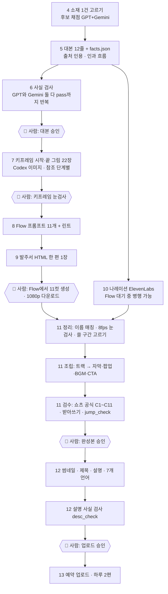

# 사라진 건축 복원 쇼츠 — 제작 구조 문서 (처음 시작하는 사람용)

> 이 문서 하나를 Codex CLI 또는 Claude Code 에 붙여 넣으면, 에이전트가 환경을 세우고 곧바로 한 편을 만들기 시작할 수 있게 쓴 문서다.
> 근거 = 「역사를 짓다 · Building History」 채널의 실제 레포(`ai-building-history-agent`)에서 17편 이상 만들며 굳은 규칙들. 날짜 기준 2026-10-12.
> 우리 레포의 허브(`ai-studio-hub`) 같은 비공개 부품은 «그 부품이 하는 일»을 설명하고, 처음 시작하는 사람이 대신 쓸 것을 적었다.
> 🔒 이 문서에는 API 키·토큰·계정 ID·개인 경로를 적지 않았다. 필요한 값은 에이전트가 사람에게 묻고 `.env`(git 밖)에만 둔다.

**한 줄 요약:** 소재 1건 고르기 → 대본(12줄·약 48초) → 사실 검사(두 AI) → 키프레임(시작·끝 그림) → Flow(Veo) 영상 8초 × 11컷 → 나레이션 → 조립·자막·검수 → 썸네일·설명 → 사람이 승인하면 업로드.

---

## 0. 이 문서를 에이전트에 넣는 법

### 0-1. 사람이 하는 일 (3줄)
1. 빈 폴더에서 Codex CLI 또는 Claude Code 를 연다.
2. 이 문서 전체를 붙여 넣고 «이 문서대로 환경을 세우고 첫 편을 만들어 줘» 라고 말한다.
3. 에이전트가 묻는 것(0-3)에 답하고, 🔴 표시가 붙은 승인 자리에서만 «승인» 이라고 말한다.

### 0-2. AGENT INSTRUCTIONS (에이전트에게 쓰는 글 — 에이전트는 이 블록을 규칙으로 따른다)

```text
너는 «사라진 건축 복원 해설 쇼츠» 제작 에이전트다. 아래 순서로 일한다.

[A. 환경 세우기 — 사람에게 묻기 전에 먼저 확인]
 1. `python3 --version`(3.10+), `ffmpeg -version`, `ffprobe -version`, `codex --version`, `gemini --version` 을 실행해 있는 것/없는 것을 표로 보고한다.
    없는 것은 설치 방법만 안내한다. 로그인·결제·비밀번호 입력은 절대 대신하지 않는다(사람이 직접).
 2. 문서 §3 의 폴더 구조를 만든다. git init 하고 `.gitignore` 에 `.env`, `work/`, `*.mp4`, `*.mp3`, `raw/` 를 넣는다.
 3. §5·§6·§8·§9 의 «복사해서 쓰는 틀»을 `tools/` 와 `templates/` 에 파일로 저장한다.
 4. `config/channel.json`(채널 이름·언어·편당 비용 상한)을 만든다. 값은 0-3 질문의 답으로 채운다.
 5. 비밀값(ElevenLabs 키 등)은 `.env` 한 파일에만 둔다. 출력·로그·커밋에 값을 찍지 않는다. `.env` 를 읽어 보여 주지 않는다.

[B. 사람에게 물을 것 — 한 번에 묶어서]
 채널 주제(국가·시대), 언어, 목소리(기본 추천 유지 여부), 편당 비용 상한(기본 $5), 업로드 주기, Flow 계정 사용 가능 여부,
 첫 편 소재를 직접 줄 것인지(1건) 아니면 후보 채점부터 할 것인지.

[C. 일하는 방식]
 - 한 번에 한 편만. 단계 순서를 건너뛰지 않는다(§1 그림). 각 단계는 «검사를 통과한 뒤에만» 다음으로 간다.
 - 사실은 출처에 있는 것만 쓴다. 출처에서 인용문을 그대로 떼어 `facts.json` 에 넣고, 대본의 모든 문장을 fact id 에 묶는다.
 - 모르면 지어내지 않는다. 출처가 갈리는 값은 쓰지 않거나 «~다고 하죠» 로 표시한다.
 - 유료 호출(나레이션 등)은 먼저 dry-run(견적)을 보여 주고, 같은 입력으로만 실행한다. 편당 상한을 넘기면 멈추고 묻는다.
 - 영상 모델(Flow/Veo)은 사람이 웹에서 직접 돌린다. 너는 «발주서»(그림 + 복사용 프롬프트 + 설정)를 만들어 주고, 받은 파일을 이름 규칙대로 정리한다.

[D. 사람 승인 없이는 절대 하지 않는 것 🔴]
 - 대본 확정 전의 키프레임 생성 / 키프레임 눈검사 통과 전의 발주서 전달
 - 유튜브 업로드·공개 전환·예약 / 채널 이름·설명·배너·핸들 변경 / 영상 삭제
 - 편당 상한 초과 지출, 새 유료 서비스 가입
 - 비밀번호·키·토큰을 대화나 파일에 적는 일
 - 실존 인물 얼굴·표정 생성, 전쟁·재난 참상 묘사, 국기·문양 글자, 저작권이 불분명한 사진 사용

[E. 각 단계가 끝나면]
 한 줄 보고: «무엇을 만들었다 · 어떤 검사를 통과했다 · 다음에 사람이 할 일». 실패했으면 원인과 고칠 방법을 먼저 쓴다.
```

### 0-3. 에이전트가 사람에게 물을 질문 (복붙용)
```text
1) 어떤 건축물/시대를 다룰까요? (우리 채널은 «초반엔 한국 건물만» 으로 시작했습니다. 한 나라·한 시대로 좁히길 권합니다.)
2) 영상 언어와 목소리: 한국어 + 남성 해설 목소리(ElevenLabs "Eungwang") 기본으로 갈까요?
3) 편당 비용 상한: 기본 $5 (나레이션은 한 편 약 $0.13~0.16) — 괜찮습니까?
4) Flow(Google 영상 도구) 계정에 로그인되어 있고, 영상은 사람이 직접 생성할 수 있습니까?
5) 첫 편 소재를 직접 주시겠어요, 아니면 후보 20개를 채점해서 1건을 골라 드릴까요?
6) 업로드는 직접 하시겠어요? (에이전트는 업로드 준비물(영상·썸네일·제목·설명)까지만 만듭니다.)
```

---

## 1. 전체 그림



| 단계 | 한 줄 설명 | 사람 관문 |
|---|---|---|
| 4 소재 | 후보 20+개 → 두 AI가 같은 기준표로 채점 → 1건 | 첫 편만 사람이 확인 |
| 5 대본 | 12줄. 줄마다 근거 fact id. 훅은 «지금 ↔ 옛 모습» | |
| 6 사실 검사 | 두 모델이 모두 pass 할 때까지. 설명란·제목도 | 🔴 대본 승인 |
| 7 키프레임 | 컷마다 시작 그림·끝 그림 | 🔴 눈검사 |
| 8 Flow 프롬프트 | 컷마다 영어 한 문단 | |
| 9 발주서 | 컷 카드(그림 2장 + 복사 버튼) | 🔴 Flow 생성은 사람 손 |
| 10 나레이션 | 한 번에 녹음 → 시간표 → 1.25배 + 쉼 줄이기 | 비용 상한 |
| 11 조립 | 컷표(cuts) → 트랙 → 자막·팝업·BGM·CTA | 🔴 완성본 승인 |
| 12 포장 | 썸네일 3안, 제목, 설명, 번역 | 🔴 업로드 승인 |
| 13 운영 | 하루 2편 슬롯, 간격, 비용 장부 | |

---

## 2. 준비물

| 무엇 | 왜 | 비용(우리 기준) | 메모 |
|---|---|---|---|
| Codex CLI (ChatGPT 구독) | 키프레임 그림 생성 + 사실 검사 1번 심사 | 구독(그림 장당 추가 0원) | 주간 한도가 있다. 우리 허브는 사용량 85% 넘으면 유료 대체로 넘어가게 했다 |
| Gemini CLI (구독) | 사실 검사 2번 심사 · 소재 채점 · 번역 검사 | 구독 | 모델: 우리는 `gemini-3.1-pro-high` 를 썼다 |
| Claude Code 또는 Codex | 이 문서를 실행하는 에이전트 | 구독 | |
| Google Flow (Veo 3.1 Fast) | 8초 영상 생성 | 구독 크레딧 | 정확한 요금제 등급은 repo 에서 확인되지 않았다 |
| ElevenLabs | 나레이션 (`eleven_v3`) | 한 번 녹음 약 $0.13~0.16 (480자 기준) | 키는 `.env` 에만 |
| ffmpeg / ffprobe | 인코딩·검사 | 무료 | `minterpolate`, `xfade` 포함 빌드 |
| Python 3.10+ | 스크립트 | 무료 | 패키지: `pillow`, `numpy`, `opencv-python-headless`(선택), `faster-whisper`(받아쓰기) |
| 유튜브 채널 | 업로드 | 무료 | 업로드는 사람이 승인 |

**비용 장부:** 나레이션처럼 돈이 드는 호출은 `work/spend.jsonl` 에 한 줄씩 남긴다(`{"at":…, "usd":…, "what":…}`). 편당 상한 기본 $5. 실험비는 제작비와 따로 센다.

---

## 3. 폴더 구조 (권장)

우리 레포 구조를 그대로 단순화했다. 편 이름은 영어 소문자·숫자·밑줄만(예: `dondeokjeon`).

```text
repo/
  AGENTS.md                  # 이 문서의 요약 + 채널 규칙 (에이전트 지시서 정본)
  DEVLOG.md                  # 작업 기록(날짜 · 한 일 · 비용)
  config/channel.json        # 채널 이름·언어·편당 상한
  .env                       # 비밀값 (git 밖)
  docs/
    topic-backlog.md         # 소재 백로그(채점 표)
    upload-schedule.md       # 업로드 슬롯 표
    flow-order-<편>.html     # 편마다 발주서 1장
  tools/                     # 공용 스크립트 (이 문서 §5~§11 의 틀)
    check_facts.py  lint_flow_prompts.py  gen_sheet.py  narrate.py
    track_scene.py  cut_track.py  smooth_slow.py  jump_check.py  flow_morph.py
    assemble.py  thumbnail.py  localize.py  queue_episode.py
  arch/
    _topics/ cand_<날짜>.json  <날짜>_pick.json     # 후보와 채점 결과
    <편>/
      script/
        script.json      # 대본 12줄 + 제목 + CTA + 설명 (정본)
        facts.json       # 사실 장부 (id · claim · 인용 quote · url)
        sources.json     # 출처 장부 · 충돌 기록 · 쓰지 않은 것
        spec.json        # 고증 사양표: 그림이 지어내면 안 되는 것
        thumb_lines.json # 썸네일 문구 후보 3안
        raw/             # 출처 원문(.html/.txt) — 인용 대조용
        draft.py  build_facts.py  check.py  desc_check.py
        fc_<라운드>_<gpt|gemini>.txt  factcheck.json     # 검사 기록
      scenes_v2.json     # 장면표
      upload.json        # 제목·설명·태그·영상/썸네일 경로·status
      cuts_v2.json  shots_v2_kw.json  sfx_v2.json        # 조립 입력(조립 때 생성)
      work/              # git 밖: 대용량
        kf_v2/<이름>/<파일>.png         # 키프레임 원본
        flow_v2/
          DD_01.txt … DD_11.txt         # 컷별 Flow 프롬프트
          jobs.json                     # 컷별 시작/끝 그림·프롬프트·설정
          keyframes/1_start.png 1_end.png …
          DD_01_r1.mp4 …                # 받은 영상(r1 = 1차 생성)
          gen_kf.py gen_flow.py gen_sheet.py gen_scenes.py check_prompts.py
        v2/
          narration_v2.mp3 narration_v2_timing.json
          narration_v2_x125_sq20.mp3 …_timing.json
          make_v2.py track_v2.py build.sh
          track_v2.mp4 track_v2.plan.json subs.ass v2.mp4 v2_asr.json
        thumb/  i18n/  spend.jsonl
```

**편 폴더 안 파일 한 줄 설명(핵심만)**

| 파일 | 담는 것 |
|---|---|
| `script.json` | `lines[]`(id·text·syllables·facts·beat), `top_title`, `cta`, `description`, `voice` 설정 |
| `facts.json` | `[{id, claim, src, url, quote, also:{src,quote}}]` — 대본의 모든 사실 |
| `sources.json` | `text_sources`(출처 이름·URL), `notes`, `conflicts`(출처가 갈린 것), `excluded`(일부러 안 쓴 것) |
| `spec.json` | 장면별 «그려도 되는 것/안 되는 것» + `do_not` 금지 목록 |
| `scenes_v2.json` | 장면표(어느 대사에 어느 컷 · 팝업 낱말) |
| `jobs.json` | Flow 컷 목록(설정 + 컷별 start/end/save_as/edit_index) |
| `cuts_v2.json` | 조립용: 클립 경로 + 장면별 쓸 구간 `[clip, t0, t1, kind, opts]` |
| `upload.json` | 유튜브 제목·설명·태그·영상·썸네일 경로 |

---

## 4. 소재 고르기

**입력:** 한 줄 주제(예: «서울의 사라진 건물»). **출력:** 소재 1건 + 첫 3초 훅 한 줄.

### 4-1. 순서
1. 후보 20~25개를 모은다(백과·국가기록·지자체·뉴스). 각 후보는 `{id, title, summary}` 한 줄. 파일: `arch/_topics/cand_<날짜>.json`.
2. 두 AI(GPT, Gemini)가 **각자** 아래 기준표로 0~10점을 매긴다(서로의 의견을 보지 못하게 따로 호출).
3. 점수 = 두 심사의 평균 × 가중치. 바닥점 미달·정책 위험은 탈락.
4. 상위에서 출처 2건 이상 확인되는 것만 남긴다. 결과: `arch/_topics/<날짜>_pick.json`.
5. 백로그 표(`docs/topic-backlog.md`)에 «훅 · 지금 자리 · 사라진 이유 · 점수 · 출처 · 옛 사진 유무»를 적는다.

### 4-2. 채점 기준표 (그대로 복사해 쓴다)
```text
각 후보를 0~10점으로 채점한다(다른 심사위원 의견은 볼 수 없다).
- wow: 지금 빈 터·폐허와 원래 모습의 차이가 첫 1~2초에 «와» 할 만큼 큰가(높이·규모·화려함).
- lost_documented: 🔴 사라진 이유·시점·경위가 기록으로 분명한가(전쟁·화재·지진·철거 등 · 연도와 출처가 있다).
- after: «왜 다시 못 세웠나(또는 복원 논의)»와 «지금 무엇이 남았나»를 기록으로 말할 수 있는가.
- evidence: 복원 그림을 지어내지 않을 고증 자료(높이·층수·평면·발굴 보고·복원 모형)가 있는가.
- moving: 영상 모델로 «솟아오름·건설·소실·비포↔애프터» 같은 움직이는 장면을 만들 수 있는가.
- policy_risk: 실존 인물 비하·전쟁 참상 묘사가 핵심이거나 사진 권리(PD·CC0·CC BY 밖)만 있으면 true.
출력은 JSON 하나: {"scores":[{"id":"<후보 id>","wow":0-10,"lost_documented":0-10,"after":0-10,"evidence":0-10,"moving":0-10,"policy_risk":false,"comment":"🪝 첫 3초: <한 줄> · <한 줄 평>"}]}
```

| 항목 | 가중치 | 바닥점(미달 탈락) |
|---|---|---|
| wow | 0.25 | |
| lost_documented | 0.25 | 3 |
| after | 0.15 | |
| evidence | 0.20 | 3 |
| moving | 0.15 | |
| policy_risk=true | | 무조건 탈락 |

동점이면 첫 3초 훅이 더 궁금한 쪽. 실제 채점에서 정책 위험으로 빠진 예: 전쟁(한강철교), 화재(시민회관), 붕괴 사고(와우아파트), 형무소.

### 4-3. 소재 고르기 규칙(학습된 것)
- 🔒 **사람에게 후보 여러 개를 주고 고르게 하지 않는다.** 에이전트가 1건을 골라 이유와 «첫 3초 훅»만 보고한다.
- 처음엔 **한 나라 건물만**. 관심과 시청이 더 모인다고 판단해 한국 건물로 시작했다.
- 이미 만든 소재와 **구조가 같은 것**(예: 도로·전차에 성벽이 헐림)은 피한다.
- **사라진 이유가 기록으로 분명한 곳**에 가점. 이유가 기록에 없으면 «~년 넘게 다시 세워지지 못했다» 같은 기록 사실만 쓴다.
- **비슷한 편은 간격을 둔다**: 이름이 겹치는 편(예: 창경궁 ↔ 종묘)은 업로드 순서를 **4편 이상** 띄운다(대표님 구두 규칙). 같은 테마 3건(한강 공원 전환)은 2편 이상. 일제 관련 소재가 연달아 붙지 않게 한다. → 더 엄격한 쪽을 권장.
- 건축물이 아니라 지형·터 이야기(섬이 육지가 됨, 쓰레기 산)는 복원 컷이 풍경 위주가 되어 채점이 높아도 후순위.
- 후보 요약의 연도는 틀릴 수 있다. 예: «전라감영은 일제 철거»라 했지만 실제는 1951 폭발 소실 → 백로그 메모에 정정을 적는다.
- 옛 사진을 쓸 계획이면 **PD · CC0 · CC BY(표기만)** 까지만. BY-SA·NC·ND 는 쓰지 않는다. (우리는 최근 편에서 실사 사진을 아예 쓰지 않고 영상 모델 장면만 썼다.)

### 4-4. 백로그 표 틀
```markdown
| 순서 | ID | 훅(지금 자리 ↔ 옛 모습) | 지금 자리 | 사라진 이유 | 점수 | 출처(2건+) | 옛 사진 |
```
같은 소재로 붙으면 안 되는 쌍은 표 아래 «메모/위험»에 적는다.

---

## 5. 대본 쓰기

**입력:** 소재 1건 + 출처 원문. **출력:** `script.json`(12줄) + `facts.json`.

### 5-1. 대본 규칙
| 규칙 | 값 |
|---|---|
| 줄 수 | 12줄(S1~S12). 줄 하나 = 장면 하나 = 영상 컷 하나(마지막 두 줄은 같은 컷 공유 가능) |
| 길이 | 최종 영상 약 45~53초(공식 B1 40~50초, 쇼츠 60초 이하) |
| 줄 분량 | 15~36음절, 평균 약 25. 전체 약 300음절 |
| 말 속도 | 6~7음절/초(실측 Eungwang 약 6.0). 느리면 컷 평균이 길어져 검사에서 막힌다 |
| 훅 S1 | **«지금 ↔ 옛 모습»**. «OO 자리에 XX가 있었다는 거 아세요?» 형식. 3초 안에 |
| 마지막 줄 | CTA: «…가 보셨나요? 다음에 되살릴 곳은 어디가 좋을까요?» (fact 없음) |
| 연기 태그 | S1 에만 `[curious]`. 빠른 해설 톤(`[excited]` `[curious]`)만. 느린 태그(`[softly]` `[whispers]` `[conspiratorial]` 등) 금지 |
| 끝 카드 문구 | «다음에 되살릴 곳 추천 / 구독·좋아요». 유튜브라 «팔로우» 금지 |
| 문체 | 존댓말 구어체, `-죠` `-요`. 평가어(«웅장한»)·감탄 금지. 출처가 확인한 사실만 |

### 5-2. 🔒 이야기 흐름 — 인과 규칙
- **원인-결정-결과**가 줄 사이에 이어져야 한다. «왜 사라졌나»가 비어 있으면 비약이다.
  - 나쁜 예: 「1919년 고종 서거」 → 「돈덕전이 헐렸다」 (왜? 가 빠짐)
  - 좋은 예: 「1919년 고종이 세상을 떠나자 덕수궁은 점점 줄어들었어요」 → 「공원으로 만드는 사업이 이어지며 1920년대에 돈덕전도 헐렸다고 하죠」
- 줄이 쓰이고 나면 **줄 사이 흐름을 따로 한 번 읽는다**(줄 하나하나가 맞아도 이음이 비면 탈락).
- 필수 세 고리(공식 B13) — 매 편 모두 넣는다:
  1. **왜 사라졌나** (언제·무엇 때문에)
  2. **왜 다시 못 세웠나 / 복원 논의** (또는 그 터에 무엇이 들어섰나)
  3. **지금 무엇이 남았나**
  «복원 결과 소개»로만 끝나면 탈락.
- 구조(연대순): 훅 → 무엇이었나 → 왜·언제 지었나 → 어떤 곳이었나 → 왜·어떻게 사라졌나 → 그 뒤 터 → 되살림 계기 → 재건·개관 → 지금 → CTA.

### 5-3. 🔒 숫자·표기 규칙
- 대본(`text`)에는 **숫자로 쓴다**: `1902년`, `381호`, `40주년`.
- 나레이션(TTS)에 보내는 글은 **한글 읽기로 바꾼다**: «천구백이 년», «삼백팔십일 호». 숫자가 그대로 가면 AI가 틀리게 읽는다. 변환 후 `script_narrate_v2.json`(`{"beats":[{"id","tagged","region"}]}`)로 저장한다.
- 화면에는 **숫자·기호로 보인다**: 팝업은 `1899`, `381호`, `적자·체증`. 자막 정렬을 위해 `--speech-sub "1899년=천팔백구십구 년"` 처럼 «화면표기=읽는표기» 쌍을 조립 때 넘긴다.
- 대본 음절 수는 숫자를 읽는 음절로 센다(`draft.py` 의 `sino()` 참고: 1902 → 천구백이).
- 출처가 갈리는 값(철거 연도·개관 일자·칸 수)은 **쓰지 않거나 범위로**: «1920년대». 연도를 단정하지 않는다.

### 5-4. 🔒 헤징(자신 없음 표시) 규칙
출처가 하나뿐이거나 출처끼리 다르거나 «추정»이라고 쓴 것은 대사에 그 표시를 남긴다.

| 출처 문장 | 대사 |
|---|---|
| 「철거된 것으로 전해진다」 | 「헐렸다고 하죠」 |
| 「아동유원지로 활용된 것으로 추정」 | 「어린이 유원지로 쓰인 것으로 추정되고」 |
| 「…내세웠다고 한다」(서울시 자료) | 「…명분을 내세웠다고 하죠」 (전언 표시를 빼면 감사에서 지적된다) |
| 단일 시민기자 글의 수치(40%) | 「상당 부분」으로 약화하거나 공식 출처를 보강 |

시청자가 암산하면 어긋나 보이는 숫자도 조심한다: «119년 만에» 와 «1923년 파괴»가 한 영상에 같이 있으면 2024−1923=101 로 읽힌다 → 한쪽을 빼거나 대사 안에서 기준을 밝힌다. «고종이 왕이 된 지 40년째인 1902년»은 «즉위 40주년»이라는 출처 문구 그대로 쓴다.

### 5-5. `script.json` 틀 (실제 필드)
```json
{
  "format": "사라진 유적·건물 복원 해설",
  "subject": "덕수궁 돈덕전(1902~1903 건립 · … · 2023-09 재건 개관)",
  "approval": "소재 백로그 10번째 — 철거 연도는 출처가 갈려 «1920년대»로만",
  "length_sec": 50.4,
  "voice": {"engine": "ElevenLabs eleven_v3", "voice": "Eungwang", "speed": 1.2,
            "post": "narrate.py --retime 1.25 --squeeze 0.2"},
  "top_title": "덕수궁 돈덕전, 백 년 만에 돌아오다",
  "hook": "아는 것 뒤집기 — «덕수궁의 서양식 영빈관이 백 년 가까이 없었다가 2023년에 다시 지어졌다» (F1)",
  "lines": [
    {"id": "S1",  "text": "[curious] 덕수궁 안에 있는 이 서양식 건물, 백 년 가까이 없었다는 거 아세요?", "syllables": 24, "facts": ["F1"], "scene": "S1", "beat": "훅 0~3"},
    {"id": "S2",  "text": "고종 즉위 40주년 행사를 맞아 1902년부터 지은 서양식 건물이죠.", "facts": ["F2"], "axis": "원래"},
    {"id": "S7",  "text": "공원으로 만드는 사업이 이어지며, 1920년대에 돈덕전도 헐렸다고 하죠.", "facts": ["F7"], "axis": "사라짐"},
    {"id": "S12", "text": "덕수궁 돈덕전, 가 보셨나요? 다음에 되살릴 곳은 어디가 좋을까요?", "facts": []}
  ],
  "cta": {"comment": "다음에 되살렸으면 하는 사라진 곳, 댓글로 알려 주세요.",
          "follow_reason": "사라진 건물과 장소를 하나씩 영상으로 되살립니다.",
          "card": "💬 다음에 되살릴 곳 추천 · 구독·좋아요", "card_s": 2.5},
  "description": "…(§12 설명란 틀)…"
}
```
(실제 파일은 12줄 전부 쓴다. `axis` 는 «원래/사라짐/되살림/지금» 중 하나로 B13 검사가 읽는다.)

### 5-6. 실제 대본 예 — 덕수궁 돈덕전 (12줄)
```text
S1  [curious] 덕수궁 안에 있는 이 서양식 건물, 백 년 가까이 없었다는 거 아세요?
S2  고종 즉위 40주년 행사를 맞아 1902년부터 지은 서양식 건물이죠.
S3  하지만 콜레라로 국제 행사는 무산돼, 그해 11월 전통 예식만 덕수궁에서 치러졌죠.
S4  그 뒤 외국 사절을 만나고 연회를 베푸는 외교 공간으로 쓰였죠.
S5  1907년엔 순종이 이곳에서 즉위했고요.
S6  그런데 1919년 고종이 세상을 떠나자 덕수궁은 점점 줄어들었어요.
S7  공원으로 만드는 사업이 이어지며, 1920년대에 돈덕전도 헐렸다고 하죠.
S8  그 터는 한때 어린이 유원지로 쓰인 것으로 추정되고, 해방 뒤엔 가건물이 들어섰죠.
S9  2017년 발굴에서 타일과 벽돌이 나왔어요.
S10 그 자취와 남은 사진, 기록으로 다시 지어 2023년 9월 문을 열었죠.
S11 지금은 안에서 대한제국 외교 이야기를 전시로 만날 수 있어요.
S12 덕수궁 돈덕전, 가 보셨나요? 다음에 되살릴 곳은 어디가 좋을까요?
```
읽는 법: S1 훅(지금↔옛) → S2~S5 무엇이었나 → **S6~S8 왜·어떻게 사라졌나** → S9~S10 되살림 → S11 지금 → S12 CTA. S3 은 «그해 콜레라» 가 처음엔 연도 근거가 없어 검사에서 지적돼 고쳐졌다.

### 5-7. `facts.json` 틀
```json
[
 {
  "id": "F7",
  "claim": "돈덕전은 덕수궁 공원화 사업으로 헐렸고, 헐린 시기는 문화재청 기준 1920년대(출처에 따라 1921~1926년 추정 또는 1930년대로 전해짐)이다.",
  "src": "SU",
  "url": "https://example.org/article",
  "quote": "돈덕전 역시 덕수궁 공원화 사업으로 헐려 나가고",
  "also": {"src": "CH", "quote": "1920년대 들어서 일제에 의해 훼철되었다."}
 }
]
```
규칙:
- `quote` 는 **출처 원문 그대로** 떼어 온 글이어야 한다. `raw/` 에 저장한 원문(공백·따옴표 정규화 후)에 실제로 들어 있는지 `build_facts.py` 가 기계로 대조한다. 안 들어 있으면 실패.
- `also` = 두 번째 출처(보강). 가능하면 공식(국가유산청·국가기록원·지자체) 1건 + 언론 1건.
- 대본 줄의 `facts` 가 비어 있으면 안 된다(CTA 제외). 한 줄에 사실이 여럿이면 id 를 모두 적는다.
- 한 출처의 기사 연도를 확인한다(2018 기사로 «지금은»을 쓰지 않는다).

### 5-8. `sources.json` 틀
```json
{
  "text_sources": {"CH": {"name": "국가유산청 보도자료 «…»(2023-05)", "url": "https://…"}},
  "notes": "성격: 정부 1차 발표 1 + 정부 발표를 전한 언론 다수.",
  "conflicts": ["철거 시기: 국가유산청 «1920년대» / 시민기자 «1921~1926 추정» / SBS «1930년대» → «1920년대»만 쓰고 연도는 쓰지 않는다(F7)."],
  "excluded": ["돈덕전이 한 번도 제대로 쓰이지 못했다는 취지: 1907 순종 즉위와 충돌 → 쓰지 않음.",
               "건물 규모(층수·면적)·양식 단정: 출처마다 달라 쓰지 않음."]
}
```

### 5-9. 고증 사양표 `spec.json` (그림이 지어내지 않게)
장면마다 `{value, src(fact id), status}` 로 «그려도 되는 것»을 적고, 마지막에 `do_not` 목록을 둔다. 실제 do_not 의 핵심:
```text
- 얼굴 클로즈업·인물 표정 금지 — 인물은 뒷모습·먼 실루엣만
- 간판·현판·표지석·한자·일본어 글자 생성 금지
- 철거 연출 금지(demolition·explosion·fire·파편) — «건물이 조용히 사라짐»으로만
- 질병·시신·군사·무기 직접 묘사 금지 (영상 모델 필터에 걸린다)
- 국기·깃발·왕실 문양 글자 금지, 황제 얼굴 묘사 금지
- 차·마차·사람은 한 방향으로만 (역주행·순간이동 금지)
- 특정 민족/국가를 악역으로 그리는 연출 금지 — 중립적인 풍경·건물 위주
- 평면 인포그래픽·표·지도 그래픽 금지 — 모든 컷은 실사풍 영상 (CTA 카드 한 컷만 예외)
- 건물 규모·층 외 세부 숫자·양식 단정 금지(출처마다 다름)
```
출처에 없는 외관은 «중립 처리»(예: «서양식 2층 건물»까지만, 프랑스풍 같은 양식 단정 금지).

### 5-10. 체크리스트 (대본)
- [ ] 12줄, 줄당 15~36음절, 총 약 300음절, 추정 길이 45~53초
- [ ] S1 훅 = 지금 ↔ 옛 모습, `[curious]` 하나만
- [ ] 모든 줄(CTA 제외)에 fact id, 모든 fact 에 원문 인용
- [ ] 역사 축 세 고리(사라짐·다시 못 세움/터·지금 남은 것)가 모두 있다
- [ ] 줄 사이 인과 흐름을 따로 읽었다
- [ ] 갈리는 값은 범위·헤징, 암산하면 어긋나는 숫자 없음
- [ ] CTA 가 «구독·좋아요» (팔로우 아님)

---

## 6. 사실 검사 (두 AI 교차)

**입력:** `script.json` + `facts.json` + `sources.json`. **출력:** `fc_<라운드>_<gpt|gemini>.txt` 기록과 `factcheck.json`.

### 6-1. 원칙
- 검사관 AI 는 **장부의 인용문(quote)만**으로 문장이 뒷받침되는지 본다. 인터넷에서 새로 찾아 «맞다»고 하지 않게 한다.
- **두 모델이 모두 pass** 할 때까지 반복한다. 한쪽만 통과해선 안 된다(실제로 GPT 는 pass, Gemini 는 fail 이 번갈아 나왔다: 돈덕전 r2 에서 Gemini 가 «전통 예식이 돈덕전 안에서 치러진 것처럼 읽힌다»를 잡았다).
- 대본뿐 아니라 **제목(T)과 설명란 본문(D)** 도 같은 검사에 넣는다. 설명란이 검사 밖이라 사실검사 전 문장이 그대로 나간 일이 있었다.
- 고치는 방향은 **주장을 약하게/좁히기** 또는 **인용 보강**. 장부에 없는 말을 새로 넣지 않는다.
- 검사 입력의 sha256 을 파일로 남긴다(검사 뒤에 대본이 바뀌지 않았는지 감사하기 위해).
- 대본을 고치면 **그 라운드부터 다시** 두 모델 모두 돌린다. 나레이션은 마지막 pass 이후 녹음한다.

### 6-2. 검사 프롬프트 (복사해서 쓴다)
```text
너는 사실 검사관이다. 아래 쇼츠 대본의 모든 문장과 유튜브 설명란 본문(D)이 «사실 장부»의 인용문(quote)만으로 뒷받침되는지 검사하라.
장부에 없는 주장, 장부와 어긋나는 숫자·연도·주체, 과장, 오해를 부르는 표현을 모두 찾아라. 연기 태그 [ ] 는 무시한다. 제목 줄(T)도 검사한다.
답은 JSON 하나만: {"verdict":"pass|fail","issues":[{"where":"S?|D|T","quote":"…","why":"…","fix_hint":"…"}]}

## 제목
T: <top_title>

## 대본
S1: <text>  (근거 F1)
S2: …

## 설명란 본문
D: <description 의 📚 출처 줄 앞부분>

## 사실 장부
F1 [KH=경향신문 …] 주장: … / 인용: «…» / 보강 [NI=뉴시스 …]: «…»
F2 …
```

### 6-3. 실행 틀 `tools/check_facts.py` (단순판)
우리는 사내 래퍼(`llmcli.codex_cli.ask_gpt`, `llmcli.antigravity_cli.ask_gemini`)로 두 CLI 를 불렀다. 처음 시작하는 사람은 아래처럼 직접 부른다. ⚠️ CLI 플래그는 버전마다 다르니 `codex exec --help`, `gemini --help` 로 확인해 고친다.
```python
import sys, json, pathlib, hashlib, subprocess
sc = json.load(open("script.json")); facts = json.load(open("facts.json")); src = json.load(open("sources.json"))["text_sources"]
desc = sc["description"].split("\n\n📚")[0]
prompt = ("너는 사실 검사관이다. …(§6-2 머리말 그대로)…\n\n## 제목\nT: " + sc["top_title"] +
  "\n\n## 대본\n" + "\n".join(f"{l['id']}: {l['text']}  (근거 {','.join(l['facts'])})" for l in sc["lines"]) +
  "\n\n## 설명란 본문\nD: " + desc + "\n\n## 사실 장부\n" + "\n".join(
    f"{f['id']} [{f['src']}={src[f['src']]['name']}] 주장: {f['claim']} / 인용: «{f['quote']}»" +
    (f" / 보강 [{f['also']['src']}]: «{f['also']['quote']}»" if f.get("also") else "") for f in facts))
who, rnd = sys.argv[1], sys.argv[2]                     # gpt|gemini, 1,2,3…
pathlib.Path(f"fc_{rnd}_{who}.prompt_sha256").write_text(hashlib.sha256(prompt.encode()).hexdigest() + "\n")
cmd = ["codex", "exec", "-"] if who == "gpt" else ["gemini", "-p", prompt]     # ⚠️ 플래그 확인
out = subprocess.run(cmd, input=prompt if who == "gpt" else None, text=True, capture_output=True).stdout
pathlib.Path(f"fc_{rnd}_{who}.txt").write_text(out); print(out[:3000])
```
두 모델을 동시에 돌리는 셸: `python3 check_facts.py gpt 1 & python3 check_facts.py gemini 1 & wait`.

### 6-4. 라운드 기록 `factcheck.json`
```json
{"scope": "대본 lines + 제목 + 설명란 본문",
 "rounds": [{"r": 1, "gpt": "<원문>", "gemini": "<원문>"}, {"r": 2, "…": "…"}],
 "final": "r3 GPT pass · Gemini pass (날짜)",
 "desc_check": "desc_check r1 (upload.json 제목·설명 전체) GPT pass · Gemini pass",
 "changes": ["r1: 제목 «백 년 없었다»→«백 년 만에 돌아오다»(100년 만에 재건은 인용 근거) · S8 «놀이터»→«유원지로 쓰인 것으로 추정»", "r2: 설명란 전통 예식 장소를 «덕수궁(경운궁)에서» 로 명시"]}
```
돈덕전 실제: r1 GPT 7건·Gemini 3건 fail → r2 GPT pass·Gemini 1건 → r3 둘 다 pass.

### 6-5. 설명란·제목 검사 `desc_check.py`
`upload.json` 의 **제목+설명 전체**(📚 출처 줄 포함)를 사실 장부·출처 장부와 대조하는 같은 구조의 검사. `📚` 줄은 출처 장부에 있는지, `🤖` 줄은 AI 고지(사실 주장 아님), 해시태그는 검사 대상 아님. 사진을 쓴 편이면 `📷` 줄을 사진 장부와 대조. 반환 JSON 에 `kind: content|credit|meta` 를 둔다. 업로드 전에 둘 다 pass.

### 6-6. 사람이 눈으로 볼 것 (AI 검사가 못 보는 것)
- **팝업·영상 안 숫자**(`shots_v2_kw.json`)는 AI 검사 대상이 아니다 → 사람이 해당 줄 대사와 대조.
- 자막 = 대본(`script_disp.json`)과 일치하는지, 받아쓰기에서 빠진 말이 없는지(§11).
- 감사(2026-10-11) 결과 자주 나온 지적 유형: ① 전언 표지 누락 ② 단일 출처 핵심 수치 ③ 화면 제목이 영상 속 «출처가 갈린다»는 말과 모순 ④ 출처 문구와 다른 숫자 계산. → 5-4 규칙으로 예방.
- 선택: 별도 «일관성/첫 3초/소재» 보조 판정(Jev)은 우리 허브 전용 도구다. 처음엔 필요 없다.

### 6-7. 체크리스트 (사실 검사)
- [ ] `build_facts.py` 가 인용문 전부를 원문에서 찾았다(불일치 0)
- [ ] GPT pass · Gemini pass (같은 최종본 기준, 입력 sha 저장)
- [ ] 제목·설명 본문 포함 검사
- [ ] 팝업 낱말·숫자는 사람이 대조
- [ ] 🔴 사람에게 대본 최종본 + 변경 내역 보고 → 승인

---

## 7. 키프레임(시작·끝 그림) 만들기

**입력:** 승인된 대본 + `spec.json`. **출력:** 컷마다 시작 그림·끝 그림(9:16 PNG) = 11컷 × 2 = 약 21~22장.

### 7-1. 개념
영상 모델(Veo)은 «시작 그림»과 «끝 그림»을 주면 그 사이를 8초 동안 움직여 이어 준다(프레임 모드). 그래서 **컷마다 두 장**이 필요하다. 한 컷 = 한 대사 장면의 «전 → 후»:

| 컷 종류 | 시작 → 끝 | 예 |
|---|---|---|
| 훅 (S1) | **지금** → **같은 구도의 옛 모습** | 지금 돈덕전 앞마당 → 같은 카메라 자리의 1900년대 |
| 건설 | 공사 중 → 완공 | 비계 → 완성 건물 |
| 사건 | 준비된 마당 → 텅 빈 마당 / 낮 → 해 질 녘 | |
| 소실 | 건물 있음 → 같은 구도에서 조용히 사라지고 잔디 | |
| 마무리 | 입구 → 물러나 첫 장면 구도로 돌아옴 (루프) | |

### 7-2. 🔒 규칙
1. **같은 구도 규칙:** 시작과 끝은 카메라 위치·높이·각도·프레이밍이 **같아야** 한다. 달라지는 건 «시간이 흐른 뒤의 모습»뿐. 이게 훅 «지금 ↔ 옛 모습» 의 핵심이다.
2. **다큐 실사 톤:** `Photorealistic documentary still, vertical 9:16`. 포토리얼, 부드러운 빛. 일러스트·평면 인포그래픽 금지.
3. **글자·로고·깃발 없음:** 모든 프롬프트 끝에 NEG(아래) 붙인다. 모델이 간판에 가짜 글자를 그리면 영상에서 제외된다.
4. **얼굴 클로즈업 없음:** 사람은 «아주 작게(tiny)», «뒷모습(seen only from behind)». 얼굴 표정·실존 인물 묘사 금지.
5. **건물 정체성 일관:** 한 편의 모든 카드에서 건물이 **같은 건물**이어야 한다. 해결책 두 가지를 같이 쓴다.
   - 건물 묘사 문장 `BLD` 를 한 번 정해 모든 프롬프트에 **똑같이** 넣는다.
   - 생성 단계를 나눠 앞에서 만든 그림을 **참조 이미지**로 준다(7-4).
6. **차·마차·사람은 한 방향:** 모든 이동체가 같은 방향. 프롬프트에 «in one direction», 필요하면 «moving away from the camera only».
7. **평면 카드 금지:** 표·지도·인포그래픽·글자 카드를 쓰지 않는다. 정보는 영상 위 팝업이 맡는다. 모든 컷이 «움직이는 실사풍 영상».
8. **고증 사양표를 벗어나지 않는다:** 규모·양식을 숫자로 단정하지 않고 «서양식 2층 건물» 수준으로.
9. **정책 필터 회피:** 질병·화재·폭파·시신·군사 묘사 대신 «조용히 비워진 마당», «건물이 조용히 사라지고 잔디». 소실 장면은 연기·파편 없이.

### 7-3. 프롬프트 틀
```text
{P}, {장소·연도·계절/시간}. {장면 묘사 한 문단}. {NEG}
```
- `P` = `Photorealistic documentary still, vertical 9:16`
- `NEG` = ` Realistic documentary look. No readable text, no letters, no signs, no banners, no logos, no flags, no close-up faces.`
- `KEEP` = `Keep EXACTLY the camera position, height, angle and framing of image 1` (끝 그림·같은 구도 그림용)
- `DES` = `Image 1 shows the building: keep its architectural design exactly, but the camera is at a new position.` (건물 디자인 참조용)
- `BLD` = 건물 한 줄 정의. 돈덕전: `a two-storey Western-style building with plain cream stucco walls, tall arched windows on both floors, a covered veranda with slender columns running along the front of both floors and a dark grey hipped roof`

### 7-4. 🔒 단계별 생성 (참조 이미지 순서)
같은 건물·같은 구도를 지키려고 4단계로 나눠 만든다(`gen_kf.py 1`~`4`).

| 단계 | 무엇 | 참조 |
|---|---|---|
| 1 | 참조 없는 시작 그림(지금 앞마당, 항공 전경, 발굴 현장, 공사 시작) | 없음 |
| 2 | 카메라 참조: 같은 구도의 다른 시대 / 건물 디자인 참조: 새 각도 | 1단계 그림 1장(image 1) |
| 3 | 옛 건물 디자인을 참조한 새 장면(행사 준비 마당, 마차 도착, 의례 행렬, 놀이터…) | 2단계의 옛 건물 그림 |
| 4 | **끝 그림**: 시작 그림을 참조해 같은 구도에서 «뒤의 모습» | 해당 시작 그림 |

### 7-5. 실제 예 (덕수궁 돈덕전)
**1단계 — 지금 앞마당 (시작, 참조 없음)**
```text
Photorealistic documentary still, vertical 9:16, present-day Seoul, South Korea at midday in early autumn. A wide locked-off view across a broad gravel courtyard with neat lawns toward a two-storey Western-style building with plain cream stucco walls, tall arched windows on both floors, a covered veranda with slender columns running along the front of both floors and a dark grey hipped roof, set in a palace garden with a few trees, tiled-roof palace halls at the far left, a few tiny modern visitors walking in one direction seen only from behind, clear pale blue sky, soft warm light. Realistic documentary look. No readable text, no letters, no signs, no banners, no logos, no flags, no close-up faces.
```
**2단계 — 같은 구도의 1900년대 (끝 그림, 참조 = 위 그림 1장)**
```text
Photorealistic documentary still, vertical 9:16. Keep EXACTLY the camera position, height, angle and framing of image 1, in the 1900s: the same cream two-storey western-style building stands exactly there, the lawns are replaced by raked gravel yard with neat edges, no modern visitors, a single horse-drawn carriage moving in one direction across the yard and a few tiny people in white Korean clothes and dark western suits walking in one direction seen only from behind, the palace halls at the left, bare hills in the far distance, soft hazy daylight. Realistic documentary look. No readable text, …, no close-up faces.
```
**4단계 — 소실의 끝 그림 (참조 = 1920년대 닫힌 건물 그림)**
```text
Photorealistic documentary still, vertical 9:16. Keep EXACTLY the camera position, height, angle and framing of image 1, years later: the building has quietly vanished and in its place is an open lawn with young trees and a curving gravel walking path, a few tiny strollers in 1920s clothes walking in one direction seen only from behind, the palace tree line behind unchanged, soft overcast light. Realistic documentary look. No readable text, …
```
(철거를 «폭파·파편»이 아니라 «조용히 사라짐»으로 쓴 점에 주목.)

### 7-6. 생성 호출 (Codex CLI)
우리 허브의 입구가 하는 일을 단순화하면 이렇다. 🔒 함정 셋:
1. `-i`(참조 이미지)는 값을 **여러 개** 먹는다 → 프롬프트를 인자로 주면 그림 경로로 읽힌다. **프롬프트는 stdin(`-`)** 으로 준다.
2. 생성 그림은 `~/.codex/generated_images/<thread_id>/…png` 에 생기고 작업 폴더로 복사되지 않을 수 있다 → 둘 다 찾는다.
3. 크기 인자가 없다 → 프롬프트 첫 줄에 `Aspect ratio 9:16 (portrait).` 를 쓴다. 비율이 4% 넘게 어긋나면 가운데를 잘라 맞춘다.

```bash
# 프롬프트 파일 앞에 붙이는 머리말(참조 N장일 때):
#   Aspect ratio 9:16 (portrait).
#   Use your image generation tool to create exactly one image from the description below.
#   Save the final image into the current working directory as <항목>.png.
#   Do not create or change any other files. Do not edit the reference images.
#   The N attached image(s) are the references, in order: image 1 … image N.
codex exec --json --skip-git-repo-check --ephemeral -s workspace-write -C <작업폴더> -i <참조1.png> [<참조2.png>] - < <항목>.txt
```
API 키 환경변수(`OPENAI_API_KEY` 등)는 비우고 **구독 로그인**으로만 돌린다. 한도 오류(`usage limit`, `429`)가 나면 시간을 두거나 다른 이미지 모델로 대체한다 — 그때는 비용이 생기니 사람에게 먼저 묻는다. 한 번에 4장 정도 병렬로 돌려도 되었다(`gen_kf.py` 는 스레드 4개).

### 7-7. 키프레임 눈검사 (🔴 사람 관문 전에 에이전트가 먼저)
정본(시작 그림)과 나란히 놓은 점검표로 본다:
- [ ] 시작과 끝의 **카메라 구도가 같은가**(건물·길·산 위치)
- [ ] 같은 건물인가(층수·지붕·창·베란다)
- [ ] 글자·로고·간판이 읽히지 않는가 / 얼굴이 크게 나오지 않았는가
- [ ] 이동체 방향이 한쪽인가
- [ ] 소실 컷의 끝 그림에 연기·파편이 없는가
- [ ] 시작≠끝이 눈에 띄게 다른가 (같으면 영상이 거의 안 움직인다)

---

## 8. Flow(Veo) 영상 프롬프트 쓰기

**입력:** 컷마다 시작·끝 그림 + 장면 의도. **출력:** `DD_01.txt` … `DD_11.txt`(영어 한 문단) + `jobs.json`.

### 8-1. 생성 설정 (고정)
| 항목 | 값 |
|---|---|
| 모드 | **프레임(Frames)**: 시작 이미지 + 끝 이미지 **둘 다** |
| 모델 | Veo 3.1 – Fast |
| 비율 | 9:16 |
| 해상도 | 720p로 생성 → **다운로드는 1080p 업스케일** |
| 길이 | **8초** (6초는 이미지 입력을 받지 않는다) |
| 출력 개수 | 1 |
| 오디오 | 오디오 생성 실패가 나면 설정에서 **«무음 동영상 반환»을 켜고** 다시 |

### 8-2. 프롬프트 구조 (순서가 있다)
```text
[1 샷 종류 + 카메라 움직임 + 장소·시간], the camera {고정 or 움직임}:
[2 시작 상태: at first …];
[3 무엇이 어떻게 바뀌나: as the years/months/hours pass in a calm time-lapse …],
[4 끝 상태], arriving exactly at the last frame.
[5 변하지 않는 것: The building, the palace hall and the mountains stay exactly the same.]
[6 스타일: Realistic documentary look, {빛}, no close-up faces, no text, no letters, no logos, no flags.]
```
필수 구절:
- **`arriving exactly at the last frame`** — 끝 그림에 정확히 도착하게 한다.
- **`stay exactly the same`** — 바뀌지 말아야 할 것(건물·산·도시)을 명시.
- **부정문은 문장 끝 스타일 줄에만**: `no close-up faces, no text, no letters, no logos, no flags`.
- 이동체: `in one direction`, 필요하면 `Every vehicle moves away from the camera only, never reversing.`
- 지금 → 옛 모습 전환은 `as the years roll backwards in a calm dissolve`.
- 카메라 문구는 **컷당 한 방향**. 반대 움직임(dolly in + out, pan left + right, tilt up + down, crane up + down, zoom in + out)을 한 컷에 섞지 않는다.
- 첫 프레임이 이미 그림으로 주어지므로 **그림에 있는 생김새를 길게 다시 묘사하지 않는다.** «움직이는 것·바뀌는 것·카메라»를 쓴다.
- 길이는 200단어 이하.
- 빈말 금지: `beautiful, stunning, epic, amazing, breathtaking, gorgeous, dynamic`. 보이는 것(재질·빛·움직임)으로 쓴다.
- 감정 낱말(`sad, angry, …`)은 몸 동작으로 풀어 쓴다(우리는 사람 클로즈업이 없어 거의 안 쓴다).
- 빠른 동작(붕괴·폭발·불길)은 쓰지 않는다. 필요하면 slow motion 으로 만들고 편집에서 가속.

### 8-3. 🔒 카메라 종류 배분 규칙 (인접 컷 대비)
편집 순서에서 **이웃한 두 컷은 «화면 크기»와 «카메라 성격»이 둘 다 달라야** 한다(린트가 막는다).
- 화면 크기: `extreme wide / wide / medium / close-up`
- 카메라 성격: `static(locked-off)` / `tracking(dolly·push-in·pan·orbit)` / `handheld` / `crane` / `aerial(drone)`

덕수궁 돈덕전 실제 배분:

| 컷 | 샷 크기 | 카메라 | 내용 |
|---|---|---|---|
| DD_01 | wide | static (locked-off) | 지금 → 옛 마당 |
| DD_02 | medium | dolly forward | 공사 → 완공 |
| DD_03 | wide | handheld drift | 행사 준비 → 텅 빈 마당 |
| DD_04 | medium | static | 사절 도착 → 해 질 녘 |
| DD_05 | wide | dolly forward | 의례 행렬 → 문 닫힘 |
| DD_06 | extreme wide | aerial drift | 전각 빼곡 → 궁역 축소 |
| DD_07 | medium | static | 닫힌 건물 → 건물이 사라지고 잔디 |
| DD_08 | wide | handheld | 놀이터 → 가건물 |
| DD_09 | medium | dolly forward + down | 발굴 현장 → 타일 |
| DD_10 | wide | static | 재건 공사 → 완공 |
| DD_11 | medium | crane rise | 입구 → 물러나 첫 구도(루프) |

### 8-4. 🔒 Flow 클립의 습성 (조립에 영향)
- 시작 그림과 끝 그림이 다른 클립은 **가운데(대략 2.5~4.5초)** 에서 디졸브·번짐(고스트)이 생기는 일이 많다. 그래서 조립에서는 **앞부분 또는 뒷부분 한쪽**만 쓴다. 지금→옛 모습 전환은 영상 모델 변형(morph)에 맡기지 않고 **같은 구도 와이프/하드컷 편집 전환**으로 이었다(§11).
- 클립의 첫·끝 0.3~0.75초는 프레임이 고정돼 멈춰 있다 → 조립 도구가 자동으로 잘라 낸다.
- 시작=끝 그림에 가까운 컷은 거의 안 움직인다. 반드시 시작≠끝.
- 모델이 가짜 글자(현판)를 그리면 그 구간은 제외.

### 8-5. 실제 프롬프트 예 (복사해서 틀로 쓴다)
**DD_01 — 훅: 지금 → 옛 모습 (static wide)**
```text
Time-lapse from a locked-off static wide shot across a broad gravel courtyard toward a cream two-storey western-style building with a veranda and a dark grey hipped roof in a palace garden in Seoul, Korea at midday in early autumn, the camera not moving: at first a few modern visitors walk in one direction on the gravel seen only from behind and neat lawns lie beside the building; as the years roll backwards in a calm dissolve the lawns turn into a raked gravel yard, the modern visitors fade away and a single horse-drawn carriage moves in one direction across the yard with a few tiny people in white Korean clothes and dark western suits walking in the same direction, arriving exactly at the last frame. The building, the palace hall at the left and the mountains stay exactly the same. Realistic documentary look, soft warm light turning to hazy daylight, no close-up faces, no text, no letters, no logos, no flags.
```
**DD_02 — 건설 (medium dolly)**
```text
Time-lapse in a medium shot with a slow smooth dolly forward toward a two-storey brick building under construction in a palace garden in Seoul, Korea in 1902, the camera gliding steadily on: at first red brick walls are half raised with bare timber scaffolding poles on the upper floor, tiny workers in plain white clothes carry bricks, seen only from behind, and stacks of bricks and timber lie in front; as the months pass in a calm time-lapse the workers leave, the scaffolding comes down and the walls are covered in cream stucco, arched windows, a balcony and a grey roof appear, until the finished building stands in a clean raked gravel yard, arriving exactly at the last frame. The tiled palace roofs and the mountains behind stay exactly the same. Realistic documentary look, hazy spring daylight, no close-up faces, no text, no letters, no logos, no flags.
```
**DD_07 — 소실 (static medium, 조용히 사라짐)**
```text
Time-lapse from a locked-off static medium shot of the front of a quiet two-storey western-style building with shuttered windows in a palace garden in Seoul, Korea in the 1920s, the camera not moving: a few weeds stand in the gravel yard and no one is there; as the years pass in a calm time-lapse the building quietly vanishes and an open lawn with young trees and a curving gravel walking path takes its place, a few tiny strollers in 1920s clothes stand along the path seen only from behind, arriving exactly at the last frame. The palace tree line and the mountains behind stay exactly the same. Realistic documentary look, flat overcast light, no close-up faces, no text, no letters, no logos, no flags.
```
**한 방향 이동 예 (전차 편 TR_01, 끝 문구)**
```text
… one old cream-and-green streetcar rolling steadily away from the camera along the rails and two old black cars driving away from the camera beside it, arriving exactly at the last frame. Every vehicle moves away from the camera only, never reversing. The sun, the hills and the street layout stay exactly in the same place. …
```
같은 편(`TR_11`)처럼 «움직이지 않는 것»을 못 박을 때: `the streetcar never moves.`

### 8-6. 프롬프트 린트 `tools/lint_flow_prompts.py` (허브의 `video_prompt_check.py` 를 단순화)
허브 검사가 보는 것: **MCSLA 다섯 칸**(Model·Camera·Subject·Look(빛/화풍)·Action) · **이웃 컷 대비(막힘)** · **카메라 충돌(막힘)** · 빈말 · 감정 낱말 · 빠른 동작 · 첫 프레임 재묘사 · 200단어. 처음 시작하는 사람용 최소판:
```python
import re, json, sys, pathlib
SIZE = [("EWS", r"extreme wide|establishing shot|panoramic"), ("CU", r"close[- ]?up"), ("MS", r"medium shot|mid[- ]shot"), ("WS", r"wide shot|wide view|long shot")]
CAM  = [("aerial", r"\baerial\b|drone"), ("crane", r"\bcrane\b|camera rises"), ("handheld", r"hand[- ]?held"),
        ("static", r"locked[- ]off|\bstatic\b|camera not moving"), ("tracking", r"dolly|tracking|push[- ]in|glides?|\bpan")]
PAIRS = [(r"dolly[- ]?(in|forward)", r"dolly[- ]?(out|back)"), (r"pan[- ]left", r"pan[- ]right"), (r"tilt[- ]up", r"tilt[- ]down"), (r"zoom[- ]in", r"zoom[- ]out")]
SLOP = r"\b(beautiful|stunning|epic|amazing|breathtaking|gorgeous|dynamic)\b"
neg = lambda t: re.sub(r"\b(no|not|never|without)\b[^,.;:]*", " ", t, flags=re.I)   # 부정한 마디는 «쓴 것»으로 세지 않는다
def kind(t, table):
    t = neg(t)
    return next((n for n, p in table if re.search(p, t, re.I)), None)
jobs = json.load(open("jobs.json"))["jobs"]; P = [pathlib.Path(j["prompt"]).read_text() for j in jobs]; bad = 0
for i, (j, t) in enumerate(zip(jobs, P)):
    if "arriving exactly at the last frame" not in t: print(f"🔴 {i+1} 'arriving exactly at the last frame' 없음"); bad += 1
    if len(t.split()) > 200: print(f"🟡 {i+1} {len(t.split())}단어 > 200")
    if re.search(SLOP, t, re.I): print(f"🟡 {i+1} 빈말")
    for a, b in PAIRS:
        if re.search(a, neg(t), re.I) and re.search(b, neg(t), re.I): print(f"🔴 {i+1} 카메라 충돌 {a} / {b}"); bad += 1
    if i:
        s0, s1, c0, c1 = kind(P[i-1], SIZE), kind(t, SIZE), kind(P[i-1], CAM), kind(t, CAM)
        if None not in (s0, s1, c0, c1) and (s0 == s1 or c0 == c1): print(f"🔴 {i+1} 앞 컷과 화면크기/카메라 성격이 같다 ({s0} {c0} → {s1} {c1})"); bad += 1
sys.exit(1 if bad else 0)
```
(허브 판은 `edit_index` 순서로 «바로 이웃한» 컷만 비교한다. 생성 순서를 바꿔 대비 검사를 피하는 것을 막기 위해서다. `jobs.json` 에 `edit_index` 를 꼭 적는다.)

### 8-7. `jobs.json` 틀
```json
{"settings": {"mode": "frames", "model": "Veo 3.1 - Fast", "aspect": "9:16", "resolution": "720p", "count": 1, "seconds": 8},
 "jobs": [
  {"prompt": "DD_01.txt", "start": "arch_dondeokjeon_h2_p_now_front_01.png", "end": "arch_dondeokjeon_h2_r_era_front_01.png",
   "save_as": "DD_01_r1.mp4", "edit_index": 1, "kind": "now", "line": "S1",
   "sub": "지금 돈덕전 앞마당 → 같은 구도 대한제국 시기 돈덕전(마차) — 고정 와이드 타임랩스", "kf": "P_NOW_FRONT → R_ERA_FRONT"}
 ]}
```
`kind`: `now`(현재 장면) / `rec`(복원 장면). 발주서 배지 색과 조립의 «복원 상상도» 배지에 쓰인다.

### 8-8. 🔒 Flow 그림 이름 충돌 방지
Flow 는 한 프로젝트에 올린 그림을 **파일 이름**으로 기억한다. 다른 편의 `S1END.png` 가 남아 있으면 새 편의 같은 이름 그림 대신 옛 그림이 들어간 사고가 있었다(원명원 ↔ 돈의문).
- 원본 키프레임 이름은 **작품 접두어**(`arch_<편>_…png`)로 시작.
- `arch/flow_guard.py`: 같은 이름·다른 내용(sha256)이 장부(`arch/data/flow_assets.json`)에 있거나, 한 이름이 다른 이름의 부분 문자열이면 🔴. 발주 직전 `--record` 로 장부에 적는다.
- 사람이 Flow 에 끌어 넣는 용 사본은 아래 §9 처럼 `1_start.png`·`1_end.png` 이름으로 따로 모은다(이 사본은 편마다 폴더가 달라 충돌 위험이 낮다 — **주의: 같은 Flow 프로젝트에서 두 편을 연달아 돌릴 때는 앞 편 그림이 목록에 남아 있다**. 새 편을 시작하기 전에 목록을 확인한다).

---

## 9. 발주서(Order sheet) 만들기

**원칙:** 발주서는 **한 편에 한 장**(여러 편을 한꺼번에 주지 않는다). 사람은 이 페이지만 열어 놓고 Flow 에서 11번 같은 일을 반복한다.

### 9-1. 발주서에 들어갈 것
1. 맨 위 노란 경고: «N컷 모두 프레임 모드 · 시작 이미지 + 끝 이미지 둘 다 · 8초 · Veo 3.1 Fast · 9:16 · 출력 1개»
2. 설정 요약, 오디오 실패 시 «무음 동영상 반환», 예상 시간(컷당 2~3분 가정), 받은 영상을 저장할 폴더와 이름 규칙(`DD_01_r1.mp4` … 카드 번호 = 편집 순서)
3. 🔒 **«📂 키프레임 폴더 열기» 버튼** — 누르면 이 편의 `keyframes/` 폴더가 Finder 로 열린다. 전체 선택(⌘A) 후 Flow 이미지 칸으로 **한 번에 끌어 넣기**. 경로 복사 버튼도 같이.
4. 🔒 **키프레임 이름 = 정확히 `1_start.png` · `1_end.png`** (카드 번호 + start/end. 편 이름 꼬리 없음). 파일 목록에서 어느 카드의 그림인지 바로 보이게 하려는 규칙이다.
5. 컷 카드 N개. 카드 하나에: 번호 · 컷 이름 · 배지(현재/복원) · 대본 줄 · 설명 · **시작·끝 그림 썸네일 2장(클릭하면 원본)** · 프롬프트 + **복사 버튼** · 설정 한 줄 · 저장 이름

### 9-2. 생성 방법 (`gen_sheet.py`)
컷마다 `keyframes/` 폴더에 사본을 모으고(이전 사본은 지우고 새로), HTML 을 만든다. 우리 구현의 핵심 함수:
```python
def kf_name(j, which):            # 끌어 넣기용 이름 — 편 꼬리 없이
    return f"{j['edit_index']}_{which}.png"          # 1_start.png, 1_end.png

def collect(jobs, flow_dir):      # 이 편 키프레임만 새로 모은다
    out = flow_dir / "keyframes"
    if out.exists(): shutil.rmtree(out)
    out.mkdir()
    for j in jobs:
        for k in ("start", "end"):
            shutil.copy2(flow_dir / j[k], out / kf_name(j, k))
```
### 9-3. 최소 HTML 골격 (복사해서 시작)
```html
<!doctype html><html lang="ko"><head><meta charset="utf-8"><meta name="viewport" content="width=device-width,initial-scale=1">
<title>Flow 수동 발주서 {{편 이름}}</title>
<style>
:root{--bg:#fafaf7;--fg:#1d1d1b;--card:#fff;--bd:#d9d6cc;--mut:#6b6a63;--warn:#fff1c2;--warnbd:#d9a400;--pre:#f0eee6}
@media(prefers-color-scheme:dark){:root{--bg:#16161a;--fg:#ecebe6;--card:#202026;--bd:#3a3a42;--mut:#a3a29a;--warn:#4a3b00;--pre:#121216}}
body{margin:0;padding:16px;background:var(--bg);color:var(--fg);font:15px/1.55 -apple-system,"Apple SD Gothic Neo",sans-serif;max-width:900px;margin:auto}
.alert{background:var(--warn);border:2px solid var(--warnbd);border-radius:10px;padding:14px;font-size:18px;font-weight:700;margin:12px 0}
.top,.card{background:var(--card);border:1px solid var(--bd);border-radius:10px;padding:14px;margin:12px 0}
.imgs{display:grid;grid-template-columns:1fr 1fr;gap:10px}img{width:100%;border-radius:6px}
.ph{display:flex;justify-content:space-between;align-items:center}
button{font:inherit;padding:6px 14px;border-radius:8px;border:1px solid var(--bd);background:var(--fg);color:var(--bg);cursor:pointer}
pre{white-space:pre-wrap;background:var(--pre);padding:10px;border-radius:8px;font-size:13px}
</style></head><body>
<div class="alert">⚠️ {{N}}컷 모두 프레임 모드 · 시작 이미지 + 끝 이미지 둘 다 · 8초 · Veo 3.1 Fast · 9:16 · 출력 1개</div>
<h1>{{채널}} · {{편 이름}} Flow 수동 발주서</h1>
<div class="top"><ul>
  <li>총 {{N}}컷 · 설정: Veo 3.1 Fast · 프레임 모드 · 9:16 · 720p · 8초 · 출력 1개</li>
  <li>오디오 실패가 나면 설정에서 ‘무음 동영상 반환’을 켜고 다시 생성</li>
  <li>받은 영상 폴더: <code>{{폴더}}</code> · 이름 규칙 <code>DD_01_r1.mp4</code> …</li></ul></div>
<!-- Finder 버튼 (mac) -->
<div class="top"><a href="bhkf://open?ep={{편}}">📂 키프레임 폴더 열기 ({{2N}}장)</a>
  <button onclick="navigator.clipboard.writeText('{{keyframes 경로}}');this.textContent='경로 복사됨'">경로 복사</button>
  <code>{{keyframes 경로}}</code></div>
<!-- 컷 카드 × N -->
<section class="card"><h2>1 · {{컷 이름}} · 대본 {{S1}}</h2>
  <p>{{한 줄 설명}} · 키프레임: {{시작 이름 → 끝 이름}}</p>
  <div class="imgs">
    <figure><a href="{{keyframes/1_start.png}}"></a><figcaption><b>시작 이미지</b> <code>1_start.png</code></figcaption></figure>
    <figure><a href="{{keyframes/1_end.png}}"></a><figcaption><b>끝 이미지</b> <code>1_end.png</code></figcaption></figure></div>
  <div class="ph"><b>프롬프트</b><button onclick="cp(this)">복사</button></div>
  <pre>{{프롬프트 전문(HTML 이스케이프)}}</pre>
  <p>설정: Veo 3.1 Fast · 프레임 모드 · 9:16 · 720p · 8초 · 출력 1개 · 저장 이름 <code>DD_01_r1.mp4</code></p></section>
<script>
function cp(b){var t=b.parentNode.nextElementSibling.innerText;function ok(){b.textContent='복사됨';setTimeout(function(){b.textContent='복사'},1500)}
if(navigator.clipboard&&window.isSecureContext){navigator.clipboard.writeText(t).then(ok,fb)}else fb();
function fb(){var a=document.createElement('textarea');a.value=t;a.style.position='fixed';a.style.opacity='0';document.body.appendChild(a);a.select();try{document.execCommand('copy');ok()}catch(e){b.textContent='실패'}document.body.removeChild(a)}}
</script></body></html>
```

### 9-4. Finder 버튼 (macOS) — 커스텀 URL 핸들러
`bhkf://open?ep=<편>` 를 받는 작은 AppleScript 앱을 `~/Applications/` 에 한 번 만들어 둔다(처음 클릭할 때 브라우저가 «열기?» 하고 물으면 허용). 안전을 위해 편 이름은 `[a-z0-9_]` 만 받는다.
```applescript
on open location theURL
	set AppleScript's text item delimiters to "ep="
	set ep to last text item of theURL
	set AppleScript's text item delimiters to ""
	set ok to do shell script "printf %s " & quoted form of ep & " | LC_ALL=C grep -Eq '^[a-z0-9_]+$' && echo yes || echo no"
	if ok is not "yes" then return
	set p1 to "<REPO>/arch/" & ep & "/work/flow_v2/keyframes"
	do shell script "if [ -d " & quoted form of p1 & " ]; then open " & quoted form of p1 & "; fi"
end open location
```
`osacompile -o ~/Applications/BHKeyframes.app thisfile.applescript` 로 만들고 Info.plist 에 `CFBundleURLTypes`(scheme `bhkf`)를 추가해야 한다. ⚠️ 이 부분은 우리 설정에서 plist 편집 내용을 repo 가 보관하지 않아 정확한 키는 확인되지 않았다(에이전트가 macOS 문서를 보고 채운다). 앱을 못 만들면 «경로 복사» 버튼만으로도 충분하다. Windows/Linux 는 이 버튼을 빼고 경로 복사만 둔다.

### 9-5. 휴대폰·다른 기기에서 보기 (선택)
발주서의 이미지 경로는 로컬 상대경로라 폰에서는 안 보인다. 폰으로 Flow 를 돌리려면 발주서 + 키프레임을 **정적 호스팅**(비공개/링크 아는 사람만, 예: Cloudflare Pages·Netlify·GitHub Pages)에 올려 링크를 연다. 규칙: ① 발주서 HTML 과 `keyframes/` 를 같은 폴더에 두고 상대경로로 참조 ② 호스팅 페이지는 검색에 걸리지 않게(noindex) ③ 영상·비밀값은 올리지 않는다. 폰에서는 Finder 버튼이 안 되므로 «이미지 길게 눌러 저장 → Flow 에서 업로드»가 된다(번거로우니 되도록 PC 로).

### 9-6. 사람이 Flow 에서 하는 일 (발주서 맨 위에 적는다)
1. Flow 프로젝트 열기 → 영상 만들기 → **프레임(Frames to Video)** 모드.
2. 카드 1: 시작 이미지 = `1_start.png`, 끝 이미지 = `1_end.png`(Finder 에서 끌어 넣기), 프롬프트 «복사» 후 붙여 넣기.
3. 설정 확인: Veo 3.1 Fast · 9:16 · 8초 · 출력 1개 → 생성.
4. 🔒 **속도 제한:** 한 편 11컷을 **하루에 몰아 걸지 않는다.** 75분에 약 16컷을 몰아 걸다 «비정상적인 활동» 경고가 두 번 나고 계정이 잠긴 적이 있다. 컷 사이 4분 이상, 시간당 8컷 이하, 하루 24컷 이하를 목표로 하고 2~3일에 나눠도 된다. 경고가 뜨면 즉시 멈춘다.
5. 완료되면 **1080p 업스케일**로 받는다. 🔒 업스케일은 **한 번에 한 개씩**(계정 전체에서 동시에 하나). 전부 1080p (대표님 규칙: «다운로드 1080으로 받아야해 전부»).
6. 다 받으면 에이전트에게 «걸었어» 라고 알린다. 완료 알림은 없다(탭을 닫아도 계속 생성).

### 9-7. 받은 영상 정리 (에이전트)
Flow 다운로드 파일 이름은 임의라 **카드에 맞춰 이름을 다시 붙인다**.
- 방법 A(수동): 한 개 받을 때마다 `DD_NN_r1.mp4` 로 바로 이름 변경.
- 방법 B(자동 매칭): 각 영상의 **첫 프레임**을 뽑아 모든 시작 키프레임과 비교해 가장 닮은 짝을 고른다(전역 최적 매칭 `scipy.optimize.linear_sum_assignment`). 닮은 컷이 둘이면 8fps 눈검사로 확정하고 `mapping.txt` 에 기록.
```bash
ffmpeg -i incoming/clip.mp4 -frames:v 1 -vf scale=72:128 first.png     # 비교용 작은 첫 프레임
```
- 받은 즉시: 파일 복사 + `sha256` 대조 + 규격 확인(`ffprobe`: 1080×1920, 24fps, 8.0초). 규격이 안 맞으면 다시 받는다.
- 같은 컷을 다시 생성하면 `DD_05_r2.mp4`.
- ✅ 받은 영상이 안전하게 복사됐으면 «다운로드 폴더의 원본은 지워도 됨» 이라고 사람에게 바로 알린다.

### 9-8. 체크리스트 (발주서)
- [ ] 프롬프트 린트 🔴 0건, `arriving exactly at the last frame` 모든 컷
- [ ] 키프레임 `1_start.png`…`N_end.png` 이름으로 모였다(2N장)
- [ ] 발주서 한 편 1장, 맨 위 경고·Finder 버튼·컷 카드 전부
- [ ] `flow_guard` 이름 충돌 0
- [ ] 사람에게 발주서를 **그 편 하나만** 전달

---

## 10. 나레이션

**입력:** `script.json` 의 12줄. **출력:** 나레이션 mp3 + **시간표(timing.json)**.

### 10-1. 설정 (채널 표준)
| 항목 | 값 |
|---|---|
| 서비스·모델 | ElevenLabs `eleven_v3` (`/v1/text-to-speech/{voice_id}/with-timestamps`) |
| 목소리 | «Eungwang» — 교육 해설 남성. 🔒 **채널 목소리를 고정**한다(기본값으로 다른 성별 목소리가 녹음된 사고가 있었다). 목소리 선택은 사람 몫 |
| voice_settings | `stability 0.5` · `speed 1.2` (허용 0.7~1.2) |
| 후처리 (무료) | `--retime 1.25`(음높이 유지 1.25배, ffmpeg `atempo`) + `--squeeze 0.2`(낱말 사이 쉼을 0.2초 이하로) |
| 결과 속도 | 약 6~6.5음절/초. 공식 C8 은 ≥6.0 |
| 비용 | 한 번 약 $0.13~0.16 (480자 기준 추정, 글자당 약 $0.0003). 편당 보통 1~3회 |

### 10-2. 순서
1. **dry-run**(견적·태그 검사) → 로그에 대본 sha 기록. 같은 대본으로만 실행 가능(대본이 바뀌었는데 이전 dry-run 으로 쏘는 사고 방지).
2. 비용 상한 확인: `지출 + 견적 ≤ 상한`.
3. 실행: 12줄을 `"\n\n"` 으로 이어 **한 번에** 보낸다(목소리·억양이 이어진다). 응답의 글자별 시각(`alignment`)에서 **줄마다 start/end** 를 계산한다(태그·공백 제외 첫/마지막 «말 글자»).
4. 후처리: `--retime 1.25 --squeeze 0.2` → `narration_v2_x125_sq20.mp3` + `…_timing.json`.
5. 지출 한 줄을 `spend.jsonl` 에 적는다.

```bash
python3 tools/narrate.py arch/<편> --script work/v2/script_narrate_v2.json --label v2/narration_v2 --speed 1.2            # dry-run
python3 tools/narrate.py arch/<편> --script work/v2/script_narrate_v2.json --label v2/narration_v2 --speed 1.2 --execute  # 유료
python3 tools/narrate.py arch/<편> --script work/v2/script_narrate_v2.json --label v2/narration_v2 --retime 1.25 --squeeze 0.2   # 0원
```
호출 본문(요약): `{"text": "<12줄을 \n\n으로 이은 글>", "model_id": "eleven_v3", "voice_settings": {"stability": 0.5, "speed": 1.2}}`, 헤더 `xi-api-key: <.env 의 키>`. 키는 코드가 `.env` 에서 직접 읽고 **출력하지 않는다**.

### 10-3. 🔒 규칙·함정
- **연기 태그는 읽히지 않아야 한다.** `[curious]` 가 철자(«G-U-R-I-E-S»)로 읽혀 앞 1.3초를 잘라 낸 적이 있다. 녹음 후 **받아쓰기 첫 낱말**을 확인하고, 읽혔다면 그만큼 앞을 자르고 시간표도 같이 당긴다(원본은 `*_pretrim` 으로 보관).
- **속도 올리는 태그**(`[fast]` `[quickly]`)와 느린 태그 금지.
- **숫자 읽기:** 숫자는 한글 읽기로 변환해 보내고(§5-3), 녹음 뒤 **받아쓰기에서 숫자가 맞게 읽혔는지** 대조(연도·%·호수). 틀리게 읽힌 낱말은 «귀로 확인 필요» 목록에 올려 사람이 듣는다.
- **쉼 줄이기가 말을 자르는 사고:** 받아쓰기(whisper)가 낱말 하나(«아뢰었죠»)를 놓치자 쉼으로 간주돼 그 말이 통째로 잘렸다 → 녹음의 글자 시각과 받아쓰기를 **합쳐서** 말 구간을 만든다(받아쓰기가 놓친 구간은 녹음 시각으로 보충).
- **너무 느리게 나온 녹음:** 컷 평균이 길어져 공식이 막힌다 → 녹음을 다시 받거나 `--retime` 을 키운다(1.35까지 쓴 적 있으나 어색해지면 대본을 줄인다). 쉼 상한을 0.2→0.12 로 줄여 말 속도를 올린 적도 있다(C8 5.97→6.06).
- 상한 도달 전에 **3회 이상 녹음하지 않는다.** 대본이 바뀐 경우만 새로 녹음.
- 나레이션은 Flow 대기 중에 병행해도 된다(대본 확정 후면 언제든).

### 10-4. 체크리스트 (나레이션)
- [ ] dry-run → execute 가 같은 대본 sha
- [ ] 받아쓰기 첫 낱말이 훅 문장의 첫 낱말 (태그가 읽히지 않음)
- [ ] 연도·수치가 맞게 읽힘, 의심 낱말은 사람이 청취
- [ ] 총 길이 45~53초, 말 속도 ≥ 6.0음절/초
- [ ] 비용 장부 갱신, 편당 상한 이내

---

## 11. 편집·조립·검수

> ⚠️ **이 채널은 숏드라마가 아니다.** (대표님 2026-10-11 «우리는 숏드라마 아니잖아».) 초기 규칙(`arch/FORMAT.md` 의 «한 화면 2~3초» «평균 ≤2.5초 / 최대 3.5초»)은 폐기됐다. 현재 규칙은 아래다. (FORMAT.md 는 일부 낡았으니 `AGENTS.md` 와 이 문서를 먼저 따른다.)

### 11-1. 🔒 편집 철학
1. **한 장면 = 그 장면의 클립 하나를 끊지 않고 쭉 보여 준다.** (필요하면 조각 안의 느린 연속 줌, 느리게 재생.)
2. **다른 장면의 클립을 빌려 사이에 끼우지 않는다.** (순서가 뒤죽박죽처럼 보인다.)
3. **같은 클립의 연속 조각 금지:** 바로 이어지는 두 조각이 같은 클립이면 시간 간격이 있든, 확대가 다르든 안 된다(점프컷). 간격 0·같은 확대면 그냥 한 조각으로 합친다. 확대 1.0→1.22 «펀치 인 계단»도 금지(빠른 이동 위에서 튄다).
4. 번짐·디졸브 구간은 **그 부분을 빼고** 앞이나 뒤 한쪽만 쓴다(같은 샷 안에서 건너뛰어 잇지 않는다).
5. 예외 하나: 훅 S1 의 **«현재 → 같은 구도 복원» xfade 와이프**(`wipe_in`, smoothleft 0.5초)는 점프컷이 아니라 편집 전환이므로 허용. (영상 모델 변형으로 이어 붙이지 않는다.)
6. 조각 안에서 느리게 재생해야 하면 **프레임 복제가 아니라 움직임 보간(minterpolate)** 으로 미리 렌더한다(복제하면 주기적 «툭툭» 끊김).

### 11-2. 장면 길이와 컷표
- 장면 창 = 이 줄의 시작 ~ 다음 줄의 시작(첫 장면은 0초부터, 마지막은 끝 + 꼬리 0.3초).
- 한 장면 = 클립 한 조각을 창 길이에 맞춰 배속: **배속 0.4~1.6**. 밖이면 조각을 다시 고른다(깨끗한 구간이 너무 짧음).
- 한 조각 출력 ≤ 8초, 조각 평균 ≤ 4초(공식 C4). 12줄 × 평균 4초 이내가 되도록 **줄 수·나레이션 속도**로 맞춘다.
- 같은 클립의 구간이 다른 장면에서 겹치지 않게. 한 클립은 한 장면에서만(마지막 두 줄이 한 클립을 끊김 없이 나눠 쓰는 경우만 예외: S11·S12).

**`cuts_v2.json` 틀 (전차 편 일부)**
```json
{
 "clips": {"TR_01": "work/flow_v2/TR_01_r1.mp4", "TR_02": "work/flow_v2/TR_02_r1.mp4"},
 "scenes": {
  "S1": [
   ["TR_01", 0.0, 1.3,   "ai_present", {"zoom": 1.0}],
   ["TR_01", 4.6, 5.476, "recon",      {"zoom": 1.0, "wipe_in": {"type": "smoothleft", "dur": 0.5}}]
  ],
  "S2": [["TR_02", 0.3, 3.532, "recon", {"zoom": 1.0}]]
 }
}
```
조각 = `[클립, 시작초, 끝초, 종류, 옵션]`. 종류:
| kind | 뜻 | 배지 |
|---|---|---|
| `recon` | 사라진 건물(복원 구조물)이 보임 | 오른쪽 위 «복원 상상도» |
| `ai_present` | AI 로 만든 현재 터·풍경(건물 없음) | 없음 (설명란에 AI 고지) |
| `real` | 실사·자체 그래픽 | 없음 |
옵션: `zoom`(확대 고정 1.0), `ramp:[1.0,1.12]`(조각 안 느린 연속 줌), `wipe_in`, `hflip`. 마지막 조각 `end` 가 `None` 이면 창 길이에 맞춰 자동으로 채운다(`make_v2.py` 가 계산).

### 11-3. 쓸 구간 고르기 (눈검사 8fps)
1. 모든 클립을 **8fps 타일**(0.125초 간격 프레임 격자)로 만들어 눈으로 본다.
2. 기계 보조: `flow_morph.py` — 광류로 이전 프레임을 휘게(warp) 한 뒤 남는 잔차로 «움직임으로 설명 안 되는 구조 변화(모프·디졸브·하드컷)» 구간을 표시. 최종 판정은 사람 눈. (이 검사의 약점: 의도된 큰 변화(철거 타임랩스)는 모프와 구분이 안 된다.)
3. 제외 구간 기록 예: «TR_01 2.9~4.4 지금→옛 디졸브 · TR_05 3.9~5.9 전차가 둘로 갈라짐 · TR_09 6.0~ 차가 튀어나옴 · TR_11 6.6~ 낙엽이 가림 · 각 클립 끝 0.3초».
4. **차량 장면은 쓴 구간마다 8fps 로 차·버스를 따라가** 뒤로 가거나 튀는 프레임이 없는지 본다(역주행·순간이동 검사).
5. 가짜 글자(현판)가 읽히는 구간, 갑자기 사람·차가 생기는(팝인) 구간, 건물 수가 바뀌는 컷 이음은 제외.
6. 첫·끝 정지 프레임은 `cut_track.trim_frozen` 이 자동으로 정지 0.3초 이상 구간을 잘라 낸다.
7. 기록은 `DEVLOG.md` 에 «제외 구간 목록»으로 남긴다.

### 11-4. 트랙 만들기 → 조립 (명령 순서 = `build.sh`)
```bash
set -e
python3 arch/<편>/work/v2/make_v2.py                         # cuts_v2.json · shots_v2_kw.json(팝업) · sfx_v2.json 생성
python3 arch/track_scene.py arch/<편> --cuts cuts_v2.json \
   --timing work/v2/narration_v2_x125_sq20_timing.json --tail 0.3 --out work/v2/track_v2.mp4
python3 arch/jump_check.py <편>                              # 같은 클립 연속 조각이면 종료코드 1 (🔴)
cd arch/<편>
python3 ../../art/assemble.py . --script script/script_disp.json \
  --timing work/v2/narration_v2_x125_sq20_timing.json --voice work/v2/narration_v2_x125_sq20.mp3 \
  --music <BGM 파일> --title "" --cta "$(printf '다음에 되살릴 곳 추천\n구독·좋아요')" \
  --out v2asm --video-track work/v2/track_v2.mp4 --shots shots_v2_kw.json --sfx sfx_v2.json \
  --layout tight --no-info --sub-words 3 --crf 27 --cta-max 2.8 --tail 0.3 \
  --speech-sub "1899년=천팔백구십구 년" --speech-sub "381호=삼백팔십일 호"
cp work/v2asm/v2asm.mp4 work/v2/v2.mp4   # 결과·자막(.ass)·받아쓰기(_asr.json)·상단 시트를 v2/ 로 복사
```
- ⚠️ `assemble.py` 는 `--out` 폴더를 **휴지통으로 보낸다** → 별도 폴더(`v2asm`)에 출력하고 결과만 복사한다.
- 인코딩은 무거우니 우리는 별도 머신으로 보냈다. 처음 시작하는 사람은 로컬 `ffmpeg` 로 충분하다(몇 분).

**`make_v2.py` 가 하는 일(요약)**
1. 나레이션 `timing.json` 의 줄 시작/끝으로 장면 창을 계산.
2. 장면별 쓸 구간을 사람이 정해 `V = {"S1": [(clip, t0, t1|None, kind, opts)], …}` 로 적는다. `t1=None` 이면 창 길이를 채우는 쪽으로 자동 계산, 배속 = 쓴 구간 길이 ÷ 창 길이.
3. `cuts_v2.json`, 팝업 `shots_v2_kw.json`, 효과음 `sfx_v2.json` 를 쓴다.

**팝업(핵심어) 만들기:** 나레이션의 글자별 시각(`alignment`)에서 **읽는 낱말의 시작 시각**을 찾아 `[시작, 끝(≤1.6초 뒤), 화면표기]` 로 적는다.
```python
SPEC = [("홍릉 행차","홍릉 행차"), ("천팔백구십구 년","1899"), ("적자","적자·체증"), ("삼백팔십일 호","381호")]   # (읽는 말, 화면표기)
```
팝업 낱말은 **`facts.json` 안의 말·숫자만**. 숫자는 digits(`1899`), 기호는 `·`. 팝업은 자막 바로 위, 주 피사체를 가리지 않게(`--pop-y 1250` 같은 고정 높이).

**글자 배치(`--layout tight --no-info`):**
- 핵심어 팝업 = 자막 바로 위
- 자막 = 아래 1/3, **한 줄 1~3단어**(`--sub-words 3`), 큰 볼드, 말에 맞춰
- 위쪽 검은 상자 없음(`--title ""`), 장면 정보 한 줄 없음
- 오른쪽 위 «복원 상상도» 배지는 `recon` 조각에서만
- 끝 카드(CTA) ≤ 3초(우리는 2.8초): «다음에 되살릴 곳 추천 / 구독·좋아요»

**소리:** BGM 은 처음부터 끝까지 끊김 없이(무음 구간 0), 음량 −21 dB 상대. 효과음: 전환(와이프/하드컷)에 짧은 «rise» 한 번(−16 LUFS). BGM·효과음은 **라이선스가 확실한 것**(자체 생성/무료 상업 이용)만. 우리 BGM 파일의 출처·라이선스는 repo 에서 확인되지 않았다.

**자막 정렬:** 자막 시각은 대본이 아니라 **영상에 들어간 나레이션의 받아쓰기(faster-whisper small)** 로 맞춘다. 자막 시작은 첫 낱말보다 0.3초 앞(`SUB_LEAD`). 받아쓰기가 낱말을 한 덩어리로 붙여 자막 밖으로 나가면 `--no-break <낱말>` 로 끊지 않을 곳을 지정한다.

### 11-5. 🔒 검수 관문 (조립 직후 에이전트가 모두 돌린다)
**쇼츠 공식 C1~C11** (우리 허브의 `shorts-formula.py`; 처음 시작하는 사람은 아래 ffmpeg 명령으로 근사)

| # | 검사 | 기준 | 근사 명령 |
|---|---|---|---|
| C1 | 첫 1초 움직임 | 0~1초에 0.4초 이상 정지 없음 | `ffmpeg -i v.mp4 -vf freezedetect=n=0.003:d=0.4 -an -f null -` |
| C2 | 3초 안 첫 전환 | 컷/디졸브/와이프 1회 이상 | `ffmpeg -i v.mp4 -vf "select='gt(scene,0.3)',showinfo" -f null -` |
| C3 | 한 화면 최대 | ≤ 8초 | 전환 사이 길이 |
| C4 | 컷 평균 | ≤ 4초 | 〃 |
| C5 | 정지 합계 | ≤ 길이의 5% | freezedetect 합계 |
| C6 | 소리 끊김 | 0.4초 이상 무음 0회 | `ffmpeg -i v.mp4 -af silencedetect=n=-45dB:d=0.4 -f null -` |
| C7 | 자막 단위 | 80% 이상이 1~3단어 | .ass 줄 분석 |
| C8 | 말 속도 | ≥ 6음절/초 | 대본 음절 ÷ 말 구간 |
| C9 | 끝 | CTA ≤ 3초 또는 첫 장면 루프 | 끝 카드 시간 |
| C10 | 길이 | ≤ 60초 | `ffprobe` |
| C11 | 움직이는 영상 비율 | 움직이는 영상 ≥ 60%, 정지 그림 ≤ 30% | OpenCV 로 프레임 쌍 비교 |

추가 관문:
- **받아쓰기 대조:** 완성본 오디오를 다시 받아쓰고 대본과 비교한 `ratio`(우리 값 0.93~0.96), `stray`(대본 밖 낱말), `outside_subs`(자막 밖 낱말 0이어야 함). 대본에 없는 말이 들리면 🔴.
- **`jump_check`:** 같은 클립 연속 조각 0건.
- **중복 프레임 0:** `mpdecimate` 등으로 프레임 복제(툭툭)가 없는지.
- **눈검사:** 첫 3초(0.5·1.5·2.5초)·끝 1초의 프레임 시트, 1fps 시트로 장면 순서가 대본과 같은지, 완성본 8fps 확인.
- **규격:** 1080×1920, 24fps, ≤ 30MB(우리는 `--crf 27`), 오디오 포함.
- **팝업 숫자**를 해당 줄 대사와 대조(AI 검사 밖).
- (선택) 자막-받아쓰기 일관성 AI 판정 — 허브 전용.

### 11-6. 자주 막히는 조합과 처방
| 증상 | 원인 | 처방 |
|---|---|---|
| `Sxx 배속 0.40 범위 밖` | 깨끗한 구간이 짧고 창이 김 | 다른 구간 고르기, 클립 재생성, 줄을 짧게 |
| C4(컷 평균) 4초 초과 | 줄이 길어 한 장면이 길다 | 줄을 나눠 컷 늘리기 / 녹음 빠르게 / 쉼 상한 줄이기 |
| C3 한 화면 길다 | 같은 클립이 이어짐 | 한 조각으로 합치되 길이는 8초 이내로 |
| C9 CTA 길다 | 꼬리/끝 카드 길다 | `--cta-max 2.8`, `--tail 0.3` |
| 점프컷 경고 | 같은 클립 조각 연속 | 한 조각으로 합침 / 다른 클립 컷 |
| 자막 밖 낱말 | 받아쓰기 낱말 붙음 | `--no-break`, `_asr_words.json` 수정본 |

### 11-7. 체크리스트 (조립)
- [ ] 장면마다 클립 한 조각(S1 와이프 한 쌍·S11/S12 연속 제외)
- [ ] 제외 구간 8fps 눈검사 기록, 차량 방향 검사
- [ ] `jump_check` 0, 공식 C1~C11 통과, 받아쓰기 `outside_subs` 0
- [ ] 팝업 낱말이 `facts.json` 안의 말
- [ ] 🔴 사람이 완성본(영상)을 보고 승인

---

## 12. 썸네일·제목·설명·번역

### 12-1. 썸네일
- **틀:** 복원 장면 한 장을 크게 아래에, 위쪽은 차콜 판 + 아이보리 글자 두 줄 + **골드는 한 단어만**. 상단 «추정 복원» 표식(전부 AI 상상 복원이라). 180px 축소 검수본을 같이 만든다(작아도 읽혀야 한다). `arch/thumbnail.py` 가 한다(Pillow, 폰트 AppleSDGothicNeo → 다른 OS 면 한글 폰트로 교체).
- 🔒 **새 그림을 생성해 얹지 않는다.** 이미 사양 검사를 통과한 복원 그림을 쓴다.
- 문구 규칙: 한 줄 **9자 이하**(공백 제외), 두 줄. 대본에 있는 사실만. **«아는 것을 뒤집는» 한 번에 읽히는 숫자·대비형**.
  - 좋은 예: «덕수궁 이 건물, / 백 년 만에 재건» (골드 = 백 년)
  - 나쁜 예: «왜 사라졌을까» 같은 미스터리 말투(🔒 금지 — «역사 미스터리 채널이잖아» 라는 지적), 어려운 고유명(«새문안로 ‘새문’» 은 이해가 안 된다는 평가)
- 3안을 `thumb_lines.json` 에 두고(대비형/역사형/결말형) 1안을 추천, 나머지는 A/B 용.
- 명령: `python3 arch/thumbnail.py --image <복원그림.png> --line1 "덕수궁 이 건물," --line2 "백 년 만에 |재건" --out work/thumb/thumb.png` (`|` 뒤가 골드 한 단어)

### 12-2. 제목
`<건물>, <숫자/대비 훅> | <키워드> #shorts` — 100자 이하. 예: «덕수궁 돈덕전, 백 년 만에 돌아온 서양식 영빈관 | 돈덕전 철거와 재건 #shorts». 검색 키워드(건물 이름 + 철거/복원)를 뒤에. 제목의 숫자도 사실 검사 대상.

### 12-3. 설명란 틀
```text
{본문 5~7문장: 사실만, 대본보다 조금 더 자세히. 출처가 갈리는 부분은 «전해집니다» 로.}

📚 출처: 기관 «기사 제목»(날짜) · 언론 «기사 제목»(날짜) · …
🤖 복원 장면과 오늘의 {장소} 장면은 기록을 바탕으로 AI로 생성했습니다. 건물 외관과 철거 과정의 세부는 확인된 기록이 적어 실제 모습과 다를 수 있습니다.

다음에 되살렸으면 하는 사라진 곳, 댓글로 알려 주세요.
사라진 건물과 장소를 하나씩 영상으로 되살립니다.

#덕수궁 #돈덕전 #대한제국 #사라진건축 #역사를짓다 #BuildingHistory #shorts
```
- 🤖 AI 고지는 필수(유튜브 «합성/변경된 콘텐츠» 항목도 켠다).
- CTA 문구가 두 줄 중복되지 않게(감사에서 지적).
- 옛 사진을 썼다면 `📷 작가·라이선스` 줄(CC BY 의무).
- `upload.json` 에 `tags`(15~20개, 한/영), `category 27(교육)`, `madeForKids false`.

### 12-4. 다국어 (제목·설명·자막)
- 언어: 원문 ko + `en ja es pt id zh-TW`.
- 번역은 GPT, **검사는 Gemini**(숫자·연도·이름·금액이 같은가, 빠진 문장이 없는가). 검사 fail 이면 지적 사항을 번역에 돌려 고치고 다시 검사(최대 3회). fail 이 남으면 멈춘다.
- 번역 프롬프트의 핵심 규칙: 숫자·연도·고유명사 그대로 · 자막 줄 수 같게 · 해시태그는 번역하되 `#BuildingHistory` `#shorts` 는 영어 그대로 · 통화 단위(원/전) 유지 · 제목 ≤100자. (첫 판은 3편 중 2편이 fail: 해시태그 중복·낱말 누락·통화 오역.)
- 자막 파일: 줄 = 대본 문장 하나 = 자막 한 칸, 시각 = 나레이션 timing 의 줄 start~end. **한국어 자막 트랙은 올리지 않는다**(화면에 이미 새겨져 있음). 외국어만.
- 연기 태그 `[ ]` 는 자막·번역에서 뺀다.

### 12-5. `upload.json` 틀
```json
{"youtube": {"video": "arch/<편>/work/v2/v2.mp4", "thumbnail": "arch/<편>/work/thumb/thumb_final.jpg",
             "title": "…", "description": "…", "tags": ["덕수궁", "돈덕전", "…"]},
 "status": "draft",
 "note": "…", "upload_order": "정동 손탁호텔과 띄움"}
```
`status`: `draft` → (영상 완성·설명 검사 pass·사람 승인) → `upload_queued`.

---

## 13. 운영

### 13-1. 승인 관문 (사람)
| 단계 | 사람이 하는 일 |
|---|---|
| 소재 | 첫 편 소재 확인(이후는 에이전트가 1건 선정·보고) |
| 대본 | 최종본 + 변경 내역 승인 |
| 키프레임 | 눈검사 후 «이 그림으로 Flow 가자» |
| Flow | **생성은 사람이 직접**(+ 1080p 다운로드) |
| 완성본 | 영상 시청 승인 |
| 업로드 | 🔴 «업로드 대기로» 가 곧 승인 (별도 승인 요청 반복 금지). 공개 전환·채널 설정·영상 삭제는 사람이 직접 |

### 13-2. 업로드 일정 (우리 기준)
- **하루 2편: 매일 12:00 · 18:00 (Asia/Seoul)**. 근거: 벤치마크 채널의 주 슬롯 + 18:00 은 실측(경희궁 18:00 공개 4시간 715회, 시간당 약 179 vs 돈의문 11:47 공개 10시간 1,391회, 약 139 — **표본 3편이라 약하다**). 1주 뒤 편당 조회수·제작 감당량으로 3편(07:00 추가) 여부를 다시 본다.
- 병목은 **사람이 Flow 에서 편당 10~11컷을 직접 돌리는 일**이다. 하루 3편은 이 병목 때문에 보류.
- 운영 계약: ① 승인된 영상만 공개 ② 각 시각에는 대기 큐에서 **가장 오래 기다린 1편** ③ 큐가 비면 그 시각은 건너뛰고 몰아서 보충하지 않는다 ④ 업로드 실패 시 같은 영상을 보완해 다시 올린 뒤 다음으로 ⑤ 다른 채널 일정을 바꾸지 않는다.
- 소재 간격: §4-3.
- 업로드는 **비공개로 올리고 예약 공개**를 쓰는 편이 안전하다. 올린 직후 **처리 상태를 3분 안에 확인**한다(과거에 영상이 «처리 중·길이 0»으로 멈춘 적 2회: 27~28MB 업로드가 410 오류·끊김 뒤에도 영상만 생성됨) — 멈추면 바로 보고하고 영수증(영상 ID)은 생성 확인 즉시 남긴다. 한 편이 여러 번 재업로드되지 않게 **영수증이 있으면 다시 등록하지 않는다**.
- 허브 없이 시작하려면: YouTube Studio 에서 직접 올리거나, YouTube Data API(OAuth 토큰은 사람이 브라우저로 1회 승인)로 올린다. 에이전트는 값만 보여 주는 dry-run 까지.

### 13-3. 비용·한도
| 항목 | 한도 |
|---|---|
| 편당 제작비 | **$5** (나레이션 약 $0.13~0.16 × 최대 3회). 실험비는 따로 |
| 상한 초과 | 멈추고 사람에게 승인 요청 |
| Codex 이미지 | 구독 주간 한도. 85% 넘으면 대체 경로(유료)로 넘어가므로 사람 승인 |
| Flow | 일일 한도·속도 제한. 계정 잠금 경험 있음(§9-6). 이 채널은 별도 계정/프로필 검토 중 |
| 시간 | 경희궁 한 편: 대본 승인→조립 약 4시간 (그중 Flow 대기가 절반) |

### 13-4. 기록
- `DEVLOG.md`: 날짜(작성 전 `date` 로 확인 — 날짜를 잘못 적은 적 있다) · 한 일 · 비용 · 제외 구간 · 검사 결과.
- 소재별 `factcheck.json`, 지출 `spend.jsonl`, 업로드 영수증 `upload-receipt.json`.
- 작업 폴더(`work/`)의 큰 파일은 git 에 올리지 않는다. 대본·장부·스크립트는 올린다.

---

## 14. 편당 체크리스트 (한 장)

```text
[ ] 4  소재 1건 선정 · 출처 2건+ · 정책 위험 아님 · 이웃 편과 간격
[ ] 5  script.json 12줄 · facts.json · sources.json · spec.json · 역사 축 3고리 · 인과 흐름 · 헤징
[ ] 6  build_facts 인용 0불일치 · GPT pass + Gemini pass(같은 최종본) · 제목/설명 포함
[ ] 🔴 대본 승인
[ ] 7  키프레임 2N장(같은 구도·같은 건물·글자/얼굴 없음·한 방향) 눈검사
[ ] 8  Flow 프롬프트 N개(arriving exactly…, 린트 🔴 0) · jobs.json(edit_index)
[ ] 9  발주서 HTML 1장 · keyframes/1_start.png… · Finder 버튼 · flow_guard 통과
[ ] 🔴 사람이 Flow 에서 N컷 생성 → 1080p 다운로드(한 개씩 업스케일) → 이름 DD_NN_r1.mp4 · sha 대조
[ ] 10 나레이션 dry-run→execute→retime 1.25/squeeze 0.2 · 첫 낱말·숫자 확인 · 비용 ≤ $5
[ ] 11 8fps 눈검사·제외 구간 기록 · cuts_v2.json(장면당 한 조각) · track → jump_check 0 → assemble
[ ] 11 공식 C1~C11 · 받아쓰기 outside_subs 0 · 팝업 숫자 대조 · ≤30MB · 1080×1920
[ ] 🔴 사람이 완성본 시청 승인
[ ] 12 썸네일 3안(≤9자·골드 1단어·180px 확인) · 제목 · 설명(📚🤖 포함) · desc_check 둘 다 pass · 7개 언어
[ ] 🔴 «업로드 대기로» → 예약 슬롯 · 업로드 후 처리 상태 3분 확인 · 영수증
[ ] DEVLOG 기록 (날짜 확인)
```

---

## 15. 자주 하는 실수 (학습된 것)

**소재·대본**
1. 후보 여러 개를 사람에게 주고 고르게 함 → 에이전트가 1건 골라 이유와 훅만 보고한다.
2. 왜 사라졌는지 없이 «복원 소개»로 끝남 → 역사 축 세 고리.
3. 출처가 갈리는 연도를 단정(철거 1920년대 vs 1921~26 vs 1930년대) → 범위/생략.
4. 전언 표시 누락(«~고 한다»가 대사에서 빠짐) → «~다고 하죠».
5. 설명란이 사실 검사 밖 → 제목·설명도 같은 라운드에 넣는다.
6. 한 모델만 pass → 두 모델 모두.
7. 팝업·영상 속 숫자를 AI 검사 대상으로 착각 → 사람이 대조.
8. 화면 제목이 영상 속 «연도가 갈린다»는 말과 모순 → 제목에 연도를 빼거나 범위로.
9. 끝 카드에 «팔로우»(유튜브엔 «구독·좋아요»).

**키프레임·Flow**
10. 시작/끝 구도가 달라 «지금→옛 모습» 이 어긋남 → KEEP 문구 + 참조 이미지.
11. 같은 건물이 컷마다 다른 건물 → BLD 고정 문장 + 디자인 참조.
12. 그림에 간판·현판 글자 → NEG 필수, 읽히는 구간 제외.
13. 소실 장면에 불·폭파·파편 → «조용히 사라짐».
14. 질병·콜레라를 직접 묘사 → 영상 모델 필터에 걸림. «행사 준비가 흩어지고 마당이 빔».
15. 이웃 컷이 같은 샷 크기·카메라 → 린트 막힘. 크기와 성격 둘 다 바꾼다.
16. 반대 카메라 움직임을 한 컷에 → 모델이 엉킨다.
17. 시작=끝에 가까운 그림 → 영상이 거의 안 움직인다(움직이는 영상 비율 미달).
18. 한 프로젝트에 같은 이름의 다른 그림 → 옛 그림이 들어감(`flow_guard`).
19. 6초 길이 선택 → 이미지 입력이 안 된다. 8초.
20. 한 편을 하루에 몰아 생성 → 계정 잠금. 간격을 두고 나눠 생성.
21. 업스케일 동시 실행 → 한 번에 하나.
22. 720p 다운로드 → 1080p 로 받는다.
23. 발주서를 여러 편 한꺼번에 전달 → 한 편씩. Finder 버튼과 `1_start.png` 이름 필수.

**편집**
24. 이 채널을 숏드라마처럼 2~3초로 쪼갬 → 폐기. 한 장면 = 한 클립 쭉.
25. 다른 장면 클립을 빌려 끼움 → «뒤죽박죽».
26. 같은 클립을 건너뛰며 이음(점프컷), 확대 1.0→1.22 계단 → 튄다. 하나로 합친다.
27. 느린 재생을 프레임 복제로 → 툭툭. minterpolate 선렌더(`scd=none` 필수, 조각당 1회, 순차 실행).
28. 클립 가운데 디졸브/모프 구간을 그대로 사용 → 8fps 눈검사로 제외.
29. 차가 뒤로 가거나 튐 → 쓴 구간마다 8fps 로 차를 따라가 본다.
30. 현재→옛 모습을 영상 모델 변형에 맡김 → 같은 구도 와이프/하드컷 + 효과음.
31. `assemble --out` 폴더가 휴지통으로 감 → 별도 폴더에 출력 후 복사.
32. 컷 평균 > 4초 / CTA > 3초 → 줄 수·녹음 속도·`--cta-max`.

**나레이션**
33. 기본 목소리로 녹음해 성별이 바뀜 → 채널 목소리 고정, 녹음 전 확인.
34. `[curious]` 태그가 읽힘 → 첫 낱말 확인 후 앞을 자름.
35. 숫자를 그대로 TTS 에 보냄 → 한글 읽기로 변환.
36. 쉼 줄이기가 받아쓰기가 놓친 낱말을 잘라 먹음 → 녹음 글자 시각과 합쳐서 구간 계산.
37. 같은 대본으로 dry-run 없이 실행 → 대본 sha 가 같은 dry-run 이 있어야 실행.

**포장·운영**
38. 썸네일에 «왜 사라졌을까» 같은 미스터리 말투 → 숫자·대비형.
39. 썸네일 새 그림을 생성해 얹음 → 이미 검사한 복원 그림만.
40. 업로드가 처리 중에서 멈춤 → 처리 상태 자동 확인, 영수증 즉시 기록.
41. 날짜를 잘못 기록 → 기록 전 `date`.
42. 작업을 이전 채널 창/레포에서 함(훅·경로가 섞임) → 새 레포 폴더에서 창을 연다.
43. 비슷한 소재가 연달아 업로드 → 간격 규칙.

---

## 16. 부록

### 16-1. 이 문서의 근거 파일 지도 (우리 레포)
| 주제 | 파일 |
|---|---|
| 채널 규칙·게이트 | `AGENTS.md`, `arch/FORMAT.md`(일부 낡음) |
| 소재 백로그·일정 | `docs/topic-backlog.md`, `docs/upload-schedule.md`, `arch/_topics/*.json` |
| 사실 확인 감사 | `docs/factcheck-audit-2026-10-11.md`, `docs/retro-2026-10-08.md` |
| 대본·사실 | `arch/dondeokjeon/script/` (`draft.py`, `facts.json`, `build_facts.py`, `check.py`, `desc_check.py`, `factcheck.json`, `spec.json`) |
| 키프레임 | `arch/dondeokjeon/work/flow_v2/gen_kf.py`, 허브 `scripts/codex_image.py` |
| Flow 프롬프트·발주서 | `arch/dondeokjeon/work/flow_v2/{gen_flow,gen_sheet,check_prompts}.py`, `DD_*.txt`, `jobs.json`, `docs/flow-order-*.html`, `arch/flow_sheet_finder.py`, `tools/bhkf.applescript`, `arch/flow_guard.py` |
| 프롬프트 린트(허브) | `ai-studio-hub/scripts/video_prompt_check.py` |
| 나레이션 | `art/narrate.py`, `arch/<편>/work/v2/script_narrate_v2.json` |
| 조립 | `arch/<편>/work/v2/{make_v2,track_v2}.py`, `build.sh`, `arch/track_scene.py`, `arch/cut_track.py`, `arch/smooth_slow.py`, `arch/jump_check.py`, `arch/flow_morph.py`, `art/assemble.py` |
| 포장 | `arch/thumbnail.py`, `arch/localize.py`, `scripts/upload_youtube.py`, `scripts/queue_episode.py` |
| 소재 채점 | `scripts/topic_score.py`, `arch/arch_restoration.py`(`TOPIC_RUBRIC`, 공식 B1~B13) |
| 쇼츠 공식 | 허브 `craft/shorts-formula.md`, `scripts/shorts-formula.py` |

### 16-2. 우리 허브(비공개)가 하는 일 ↔ 처음 시작하는 사람이 대신 쓸 것
| 허브 부품 | 하는 일 | 대신 |
|---|---|---|
| `image.py` + `codex_image.py` | Codex CLI 로 키프레임 생성 + 승인 장부·영수증·한도 감시 | §7-6 의 `codex exec` 직접 호출 |
| `video_prompt_check.py` | Flow 프롬프트 린트(MCSLA·대비·충돌) | §8-6 최소 린트 |
| `shorts-formula.py` | 쇼츠 공식 C1~C11 | §11-5 ffmpeg 근사 명령 |
| `flow-web.py` | Flow 웹 자동 다운로드(1080p)·잠금·속도 제한 | 사람이 직접 다운로드 + §9-7 이름 매칭 |
| `ffmpeg-remote.py` | 무거운 인코딩을 다른 머신으로 | 로컬 ffmpeg |
| `approval_queue.py` + 예약 실행기 | 업로드 승인 대기열 + 슬롯 시각에 자동 업로드 | YouTube Studio 예약 공개 또는 직접 업로드 |
| `llmcli.*` (사내 래퍼) | GPT/Gemini CLI 호출·사용 기록 | §6-3 `subprocess` |
| Jev | 소재·첫 3초·일관성 보조 판정(경고) | 생략 가능 |

### 16-3. 이 문서에서 repo 만으로 확정하지 못한 것 (정직하게)
1. **Flow 요금제 등급·정확한 UI 문구**: 우리 발주서의 한국어 라벨(프레임 모드, «무음 동영상 반환»)을 그대로 적었으나 Flow UI 는 바뀔 수 있다.
2. **Codex/Gemini CLI 플래그**: 우리는 사내 래퍼로 호출했다. §6-3 의 `codex exec -` / `gemini -p` 는 일반적 형태이며 설치된 버전에서 `--help` 로 검증해야 한다. 이미지 생성이 `codex exec` 에서 어떻게 켜지는지는 구독·버전에 의존한다.
3. **`script_narrate_v2.json` 생성기**: 숫자→한글 읽기 변환 결과 파일은 있으나, 변환 스크립트 자체는 편마다 인라인이거나 수작업으로 보인다(`draft.py` 의 `sino()` 는 음절 계산용). 에이전트가 변환 함수를 직접 만든다.
4. **BGM 파일의 출처·라이선스**: 조립 예제는 이전 편의 음악 파일을 재사용한다(`art_222.flac`). 정확한 출처는 repo 에서 확인되지 않았다. 새 채널은 자체 라이선스가 확실한 BGM 을 준비해야 한다.
5. **`bhkf://` 앱의 Info.plist 설정**: repo 에는 AppleScript 원본만 있고 URL scheme 등록 절차는 없다(§9-4).
6. **받아쓰기 `ratio` 합격 기준**: 실측 0.93~0.96 만 확인. 코드에 «이 값 미만 실패» 같은 임계는 찾지 못했다(`outside_subs` 0 은 강제).
7. **돈덕전의 현재 상태**: 대본·사실검사·키프레임·발주서까지 완료. 영상(Flow)·조립은 아직이다. 조립 설명은 같은 규칙으로 완성된 전차(`tram`) 등의 `make_v2.py`/`build.sh` 를 근거로 했다.
8. **`FORMAT.md` 낡은 규칙**: «한 화면 2~3초», «평균 ≤2.5초», 목소리 «1.1배속», «H3 기본 꺼짐» 등은 폐기/대체됐다(AGENTS.md 2026-10-11 규칙). 문서 간 충돌 시 AGENTS.md 와 이 문서가 이긴다.
9. **간격 규칙의 정확한 수치**: 백로그는 «2편 이상», 구두 규칙은 «4편 이상(이름 겹침)». 더 엄격한 쪽을 권했다.

### 16-4. 첫 편을 시작하는 가장 짧은 길
1. §0 을 에이전트에 붙여 넣는다 → 환경 확인 → §3 폴더 생성.
2. 소재 1건을 사람이 정한다(§4) → 에이전트가 출처 원문을 `raw/` 에 저장.
3. §5 대본 + facts → §6 두 모델 pass → 🔴 승인.
4. §7 키프레임 → §8 프롬프트 → §9 발주서 → 사람이 Flow.
5. Flow 대기 중 §10 나레이션.
6. 영상이 오면 §11 조립 → 검수 → 🔴 승인 → §12 포장 → 🔴 업로드 승인.
